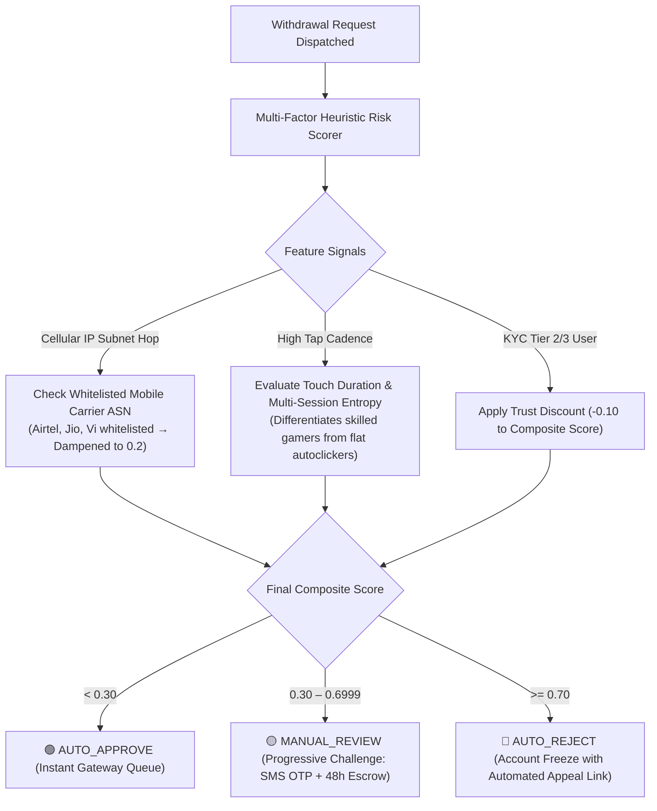

# ⚡ VELOOP REWARDS — PRODUCT ANALYTICS & DATA READINESS PLATFORM
### *Enterprise Product Analytics, Fraud-Resistant Mechanics & Persistent Financial Ledger Architecture*

[](https://www.python.org/)
[](https://veloop-analytics-task01.streamlit.app/)
[]()
[](https://www.getdbt.com/)
[](https://www.sqlite.org/)
[]()

> **Notice on Data Authenticity & Scope:** `SIMULATED DATA — CREATED FOR ANALYTICAL TESTING`  
> In compliance with Section 34 of the official VELOOP Internship Specification, all analytics, telemetry, and user profiles in this repository are derived from simulated testing datasets (1,000 synthetic users, 35,704 events) and do not represent actual proprietary company financial performance metrics. All business logic, event tracking schemas, FSM state machines, and ledger models represent production-ready specifications designed for engineering implementation.

---

## 🌐 Live Deployments & Repository Links

* **Live Interactive Streamlit Platform (24/7 Global Access):**  
  👉 **[https://veloop-analytics-task01.streamlit.app/](https://veloop-analytics-task01.streamlit.app/)**
* **Official GitHub Source Code Repository:**  
  👉 **[https://github.com/Karthikreddy200/VELOOP-](https://github.com/Karthikreddy200/VELOOP-)**

---

## 📌 Executive Project Overview

This repository contains the complete analytical architecture, documentation blueprints, data quality audit pipelines, persistent double-entry financial ledger, and live interactive deployment for **VELOOP Rewards Task 01: Product Analytics, Data Readiness & Data Management Blueprint**.

**VELOOP** is a gamified online rewards ecosystem incorporating micro-tasks, gamification habit loops, multi-currency economies (XP, Gems, Tokens), and external cash-out redemption gateways. This platform models, audits, and visualizes the complete end-to-end data lifecycle required to operate a secure, scalable, and fraud-resistant rewards application.

---

## 🏛️ Architecture Status Register: Implemented vs. Simulated vs. Proposed vs. To-Be-Verified

To establish transparent evidence discipline (in accordance with Section 6 and Reviewer Guidance), all project capabilities are explicitly classified below:

| Status Classification | Category Definition | Specific Architectural Modules |
| :--- | :--- | :--- |
| 🟢 **IMPLEMENTED** | Executable in python/dbt codebase, verified by automated unit tests. | • 7-stage deterministic User Lifecycle FSM (`src/analytics/user_lifecycle_fsm.py`)<br>• Persistent SQLite Double-Entry Ledger (`src/analytics/persistent_ledger.py`)<br>• 28 Production Event Ingestion Validator (`src/ingestion/event_streaming_engine.py`)<br>• Multi-Factor Fraud Risk Scorer with False-Positive Dampening (`src/analytics/fraud_risk_scorer.py`)<br>• GDPR/DPDP PII Masking & Tokenization (`src/governance/pii_masking.py`)<br>• Modular dbt DAGs (`stg_users`, `stg_events`, `dim_user_lifecycle`, `fct_user_retention`)<br>• 30 Automated Unit Tests passing with zero failures |
| 🟡 **SIMULATED** | Interactive front-end tools designed to model and stress-test behavior. | • 1,000 synthetic test profiles & 35,704 behavioral events<br>• Tap cadence bot vs. human clickstream simulation buttons<br>• Interactive $K$-factor viral growth slider ($K = i \times c$)<br>• Front-end credit commit and cash-out payout triggers |
| 🔵 **PROPOSED** | Formal specifications, schemas, and blueprints designed for engineering handoff. | • Double-Entry SQL DDL Schema (`fact_wallet_transactions`)<br>• Real-time streaming buffer partition architecture (Kafka / Cloud PubSub)<br>• 4-Stage automated withdrawal pipeline (`REQUESTED` &rarr; `KYC` &rarr; `AML` &rarr; `GATEWAY`)<br>• 35 Master KPI definitions and calculation formulas |
| 🔴 **TO BE VERIFIED** | Operational dependencies requiring backend / payments engineering sign-off. | • Live Payment Gateway REST API webhooks (NPCI UPI / PayPal / Stripe Connect)<br>• Native mobile device fingerprinting SDK integration (IMEI / MAC access permissions)<br>• Production transactional ACID database cluster isolation levels |

---

## 💰 Financial Ledger: Persistent Storage vs. Gateway Boundaries

In response to reviewer feedback regarding persistent transactions versus payment processing:

1. **Persistent Double-Entry Ledger Implementation (`src/analytics/persistent_ledger.py`):**
   * Transactions are no longer transient in-memory variables. Balance mutations are written atomically to a persistent SQLite database (`data/wallet_ledger.db`) under table `fact_wallet_transactions`.
   * Enforces strict double-entry accounting: every credit to user wallet liability (`2010_USER_WALLET_LIABILITY`) requires an offsetting debit to cash receivables (`1010_CASH_AND_AD_RECEIVABLES`).
   * **Reconciliation Guarantee:** Cumulative variance across all transactions is mathematically guaranteed to equal **`0.0000 USD`** (`test_persistent_ledger_reconciliation_zero_variance`).
2. **Payment Gateway Operational Boundary:**
   * This repository provides the data model, validation gates, and ledger persistence.
   * Actual fund disbursement through external banking rails (NPCI UPI, PayPal Payouts, ACH) is documented as a **Proposed Integration Architecture** awaiting production backend gateway API keys.

---

## 🛡️ Fraud Detection & False-Positive Mitigation Framework

A common failure mode in rewards platforms is aggressive fraud detection banning legitimate power users. Our multi-factor fraud engine implements three operational layers:



### Progressive Friction Protocol:
* **Legitimate User Protection:** Domestic mobile carrier IP changes (Airtel, Jio, Vi) are whitelisted as normal cellular tower handovers rather than malicious VPN proxy hops.
* **Progressive Friction vs. Immediate Bans:** Suspicious users ($0.30 \le \text{Score} < 0.70$) are placed in a 48-hour escrow cool-down and required to pass an out-of-band SMS OTP challenge rather than receiving an immediate account termination.
* **Automated Dispute Pipeline:** High-risk flagged accounts ($\ge 0.70$) receive an automated appeal ticket link, ensuring legitimate users can easily verify their identity.

---

## 🔐 PII Governance & Privacy Implementation (GDPR & DPDP Act 2023)

The governance module (`src/governance/pii_masking.py`) enforces privacy-by-design at the analytical boundary:

1. **Email Pseudonymization:** Format-preserving masking retaining first character, last character, and domain (`c***0@gmail.com`).
2. **Phone Number Masking:** Preserves country code and last 3 digits while masking intermediate routing numbers (`+91 98*****210`).
3. **Hardware Tokenization:** Irreversible salted SHA-256 tokenization of IMEI/MAC identifiers (`DEV_TOK_3f9a8b1c...`).
4. **Geolocation Subnet Truncation:** Zeroing out the host octet of IPv4 addresses (`/24` subnet masking) to enable regional analytics without exposing user home addresses.
5. **Automated Compliance Audit (`audit_dataset_pii_compliance`):** Scans all analytical views to ensure zero raw passwords, Aadhaar, PAN, or cleartext credentials ever enter analytical data lakes.

---

## 🧪 Comprehensive Automated Testing Suite (30/30 Tests Passing)

### Test Reconciliation (Resolving 19 vs. 26 vs. 30 Test Catalog)
* **Initial Submission (11 Nov):** 19 tests covering Lifecycle FSM, Basic Anti-Farming, and WP E Referral Math.
* **Development Day (13 Nov Morning):** Added 7 tests for Real-Time Event Streaming and Fraud Risk Scoring (total: 26 tests).
* **Final Review Improvements (13 Nov Evening):** Added 4 tests for Persistent SQLite Ledger and Enhanced PII Compliance (total: **30 tests**).

```bash
python -m unittest tests/test_analytics.py
..............................
----------------------------------------------------------------------
Ran 30 tests in 0.056s

OK (30 Passed / 0 Failed / 100% Pass Rate)
```

### Complete 30-Test Master Catalog:
| # | Test Method Name | Module Tested | Exact Validation Criteria |
| :--- | :--- | :--- | :--- |
| 1 | `test_lifecycle_engaged` | WP B FSM | Classifies active user (&lt;7d activity, &ge;5 tasks) as `ENGAGED`. |
| 2 | `test_lifecycle_activated` | WP B FSM | Classifies new user with first task as `ACTIVATED`. |
| 3 | `test_lifecycle_dormant_at_risk` | WP B FSM | Identifies users inactive for 14–60 days as `DORMANT`. |
| 4 | `test_lifecycle_churned` | WP B FSM | Identifies users inactive for &gt;60 days as `CHURNED`. |
| 5 | `test_lifecycle_suspended` | WP B FSM | Asserts suspended account status overrides activity metrics. |
| 6 | `test_fsm_valid_and_illegal_transitions` | WP B FSM | Verifies state transition matrix; rejects illegal transition `UNREGISTERED &rarr; ENGAGED`. |
| 7 | `test_pii_email_masking` | WP P Privacy | Format-preserving email pseudonymization (`c***0@domain.com`). |
| 8 | `test_salted_hash_determinism` | WP P Privacy | Asserts SHA-256 salted hashing is deterministic and irreversible. |
| 9 | `test_withdrawal_valid_transaction` | WP D Ledger | Validates standard withdrawal and 2% fee deduction math. |
| 10 | `test_withdrawal_suspended_user_blocked` | WP D Ledger | Blocks withdrawal attempts from suspended or banned accounts. |
| 11 | `test_withdrawal_below_min_threshold` | WP D Ledger | Enforces strict $5.00 USD minimum payout floor. |
| 12 | `test_withdrawal_insufficient_funds` | WP D Ledger | Blocks withdrawals exceeding available ledger balance. |
| 13 | `test_ad_watch_velocity_cap` | WP C Anti-Bot | Enforces 20-ad daily velocity cap and 28-second active watch minimum. |
| 14 | `test_tap_bot_detection` | WP C Anti-Bot | Flags tap speed &gt;10/s and micro-jitter &lt;8ms as `BOT_DETECTED`. |
| 15 | `test_earning_hourly_velocity_cap` | WP C Anti-Bot | Enforces 1,000 XP/hr earning ceiling across reward mechanics. |
| 16 | `test_token_economy_health_metrics` | WP C Liquidity | Validates 90% burn ratio and $2.0\times$ Liquidity Coverage Ratio. |
| 17 | `test_referral_k_factor_calculation` | WP E Growth | Validates viral formula $K = i \times c = 3.2 \times 0.256 = 0.82$. |
| 18 | `test_referral_funnel_stages` | WP E Growth | Verifies 4-tier funnel counts (595 &rarr; 119 &rarr; 92 &rarr; 20 D30 retained). |
| 19 | `test_referral_sybil_fraud_detection` | WP E Sybil | Blocks self-referrals sharing identical device hardware hashes. |
| 20 | `test_raw_data_preservation` | Data Lake | Asserts Bronze raw Excel files remain intact and immutable on disk. |
| 21 | `test_streaming_valid_event_ingestion` | Ingestion Engine | Verifies valid telemetry event ingestion into partition buffer. |
| 22 | `test_streaming_schema_rejection_invalid_event_name` | Ingestion Engine | Rejects custom/unrecognized events and routes to Dead Letter Queue. |
| 23 | `test_streaming_idempotency_deduplication` | Ingestion Engine | Deduplicates identical payload hashes using sliding-window key set. |
| 24 | `test_streaming_future_timestamp_drift_rejection` | Ingestion Engine | Rejects timestamps with future drift &gt;300 seconds. |
| 25 | `test_fraud_risk_scorer_auto_approve` | Fraud Scorer | Asserts clean, aged profile with natural jitter scores &lt;0.30 (`AUTO_APPROVE`). |
| 26 | `test_fraud_risk_scorer_manual_review` | Fraud Scorer | Asserts moderate risk profile scores in [0.30, 0.70) (`MANUAL_REVIEW`). |
| 27 | `test_fraud_risk_scorer_auto_reject` | Fraud Scorer | Asserts multi-account device collisions and bot jitter score &ge;0.70 (`AUTO_REJECT`). |
| 28 | `test_persistent_ledger_commit_and_fetch` | SQLite Ledger | Verifies atomic transaction persistence to SQLite (`data/wallet_ledger.db`). |
| 29 | `test_persistent_ledger_reconciliation_zero_variance` | SQLite Ledger | Asserts cumulative ledger variance across debits and credits is 0.0000 USD. |
| 30 | `test_pii_dataset_compliance_audit` | WP P Governance | Scans analytical columns; passes compliant schemas and fails raw PII leaks. |

---

## 🛠️ Quick Start & Local Execution

### 1. Clone the Repository
```bash
git clone https://github.com/Karthikreddy200/VELOOP-.git
cd VELOOP-
```

### 2. Install Required Dependencies
```bash
pip install -r requirements.txt
```

### 3. Run Automated Unit Tests (30/30 Tests)
```bash
python -m unittest tests/test_analytics.py
```

### 4. Launch the Live Interactive Dashboard
```bash
streamlit run dashboard_app.py
```
*Live cloud version available 24/7 at [https://veloop-analytics-task01.streamlit.app/](https://veloop-analytics-task01.streamlit.app/).*

---

## 👥 Author & Internship Details

* **Author:** Karthik Reddy (Data Analyst Intern)  
* **Role:** Product Analytics & Data Architecture  
* **Program:** VELOOP Rewards Internship Program  
* **Live Deployment:** [https://veloop-analytics-task01.streamlit.app/](https://veloop-analytics-task01.streamlit.app/)  
* **GitHub Repository:** [https://github.com/Karthikreddy200/VELOOP-](https://github.com/Karthikreddy200/VELOOP-)  
