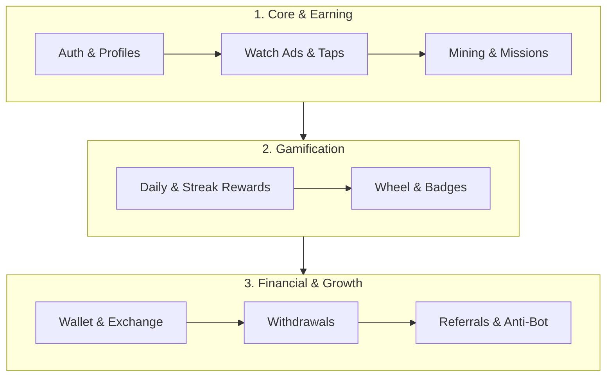
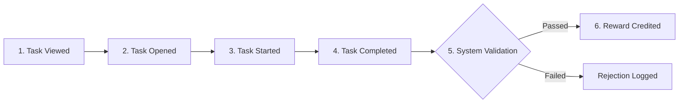
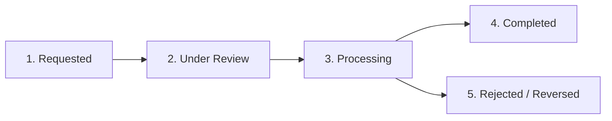
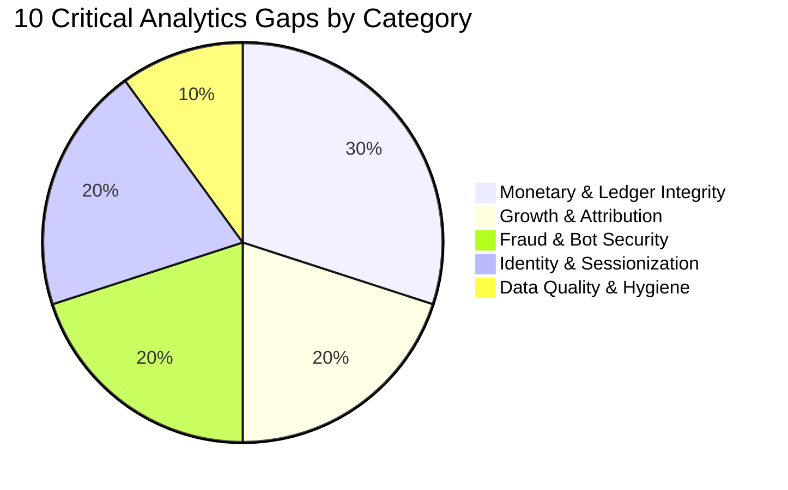

# VELOOP REWARDS DATA ANALYST INTERNSHIP
## MILESTONE PROGRESS REPORT: DAYS 1–3
**Schedule Reference:** Section 31 (Days 1–3 of 22–25 Day Schedule — Phase 1 Discovery & Data Audit)  
**Deliverables Covered:**  
* **Days 1–2:** Product Documentation Review & Source & Verification Register (Deliverable 21a)  
* **Day 3:** Work Package A — Product Data Readiness Audit & Comprehensive Data Coverage Matrix (Deliverables 02 & 03)  
**Classification:** `SIMULATED DATA — CREATED FOR ANALYTICAL TESTING`  
**Status Standard:** `Confirmed` | `Proposed` | `To Be Verified`  
**Author:** Karthik Reddy, Data Analyst Intern — VELOOP Product Analytics  
**Date Submitted:** November 4, 2026  

---

## 1. Executive Summary: Days 1–3 Progress

During the first 3 days of the VELOOP Rewards Data Analyst Internship, the technical and analytical foundation was established according to the official schedule:

1. **Days 1–2 (Product Discovery & Evidence Discipline):** Systematically reviewed all product documentation across the 15 simulated product modules. Established the **Source & Verification Register** (26 cataloged items across Confirmed, Proposed, and To Be Verified) and enforced the strict anti-assumption protocol mandated in Section 6.
2. **Day 3 (Work Package A — Product Data Readiness Audit):** Mapped user journeys against automated system decisions across all 15 features, established the strict **3-Tier Delineation** (User Events vs. System Events vs. Business Outcomes), constructed the **Comprehensive Data Coverage Matrix**, and identified the **Top 10 Mission-Critical Analytics Gaps** that currently compromise platform telemetry and financial reconciliation.

> [!IMPORTANT]
> **Data Authenticity Notice (Section 34):** In strict accordance with the non-negotiable integrity policy, all findings in this report are based on the initial product specification and simulated dataset (`VELOOP_Simulated_User_Behavior_1000.xlsx`). Simulated telemetry is strictly labeled as **SIMULATED DATA — CREATED FOR ANALYTICAL TESTING** and is never represented as actual proprietary company metrics.

---

## 2. Days 1–2 Foundational Recap: Scoping & Source Register

### 2.1 The 15 Functional Modules
A systematic audit of VELOOP's product context and simulated datasets (`03_Feature_Events`, `Users_1000_Clean`, `05_Task_Activity`) confirmed 15 functional modules:
* **Core Auth:** User Registration, Login & Session Management.
* **Earning Tasks:** Watch Ads (Rewarded Video), Tap & Earn, Mining Rewards, Missions, Follow & Earn.
* **Gamification:** Daily Rewards calendar, Streak Multipliers, Spin the Wheel (RNG), Badges & Levels, Competitive Leaderboard.
* **Monetary & Ledger:** Wallet balances, Exchange Center, Withdrawals & Payout Gateways.
* **Security & Growth:** CAPTCHA & Bot Detection, Referral Viral Loops.

### 2.2 Source & Verification Register Summary (Deliverable 21a)
To ensure strict evidence discipline, 26 technical capabilities were cataloged:
* 🟢 **Confirmed (11 items):** Factually observed in telemetry (35,704 clickstream events, 9,846 task records, 7,913 sessions).
* 🔵 **Proposed (8 items):** Architected analytical models designed to solve unrecorded states (Double-entry ledger, 6-stage withdrawal machine, idempotency keys, SHA-256 PII masking).
* 🔴 **To Be Verified (7 items):** Operational unknowns requiring backend engineering sign-off (Ad network HMAC signatures, real-time CDC event emission, payout webhooks, database constraints).

---

## 3. Day 3 Core Deliverable: Work Package A — Product Data Readiness Audit (Deliverable 02)

### 3.1 A1. Product Area & User Journey Mapping

| Product Area | Feature / Module | User Action | System Outcome | Data Required | Business Question Addressed | Status |
|---|---|---|---|---|---|---|
| **Account** | Registration | User submits form / SSO | Account provisioned; confirmation sent | `user_id`, `reg_datetime`, `channel`, `device` | Which marketing channels yield active accounts? | Confirmed |
| **Account** | Login | Submits credentials / biometrics | Session token generated; JWT issued | `user_id`, `session_id`, `login_datetime` | What is our true DAU vs background refresh hits? | Confirmed |
| **Earning** | Watch Ads | Taps ad card; views 30s video | Ad impression verified; reward credited | `user_id`, `ad_unit_id`, `duration_sec`, `reward_id` | Which ad networks deliver completed views vs drop-offs? | Confirmed |
| **Earning** | Tap & Earn | Taps interactive screen canvas | Tap counter incremented; anti-bot checked | `user_id`, `tap_count`, `duration_ms`, `multiplier` | What is the average session fatigue point for micro-tapping? | Confirmed |
| **Earning** | Mining Rewards | Initiates mining session timer | Cloud timer started; yield accumulated | `user_id`, `start_time`, `yield_rate`, `end_time` | Does passive earning drive sustained retention? | Confirmed |
| **Earning** | Missions | Starts structured challenge | Progress tracked; validation verified | `user_id`, `mission_id`, `criteria_met`, `xp_awarded` | Do structured missions improve Day-7 retention cohorts? | Confirmed |
| **Earning** | Follow & Earn | Taps social follow link | S2S verification pinged; reward unlocked | `user_id`, `platform_name`, `target_account`, `status` | What is the conversion efficiency of social tasks? | Confirmed |
| **Gamification** | Spin the Wheel | Taps spin button | RNG algorithm assigns prize tier | `user_id`, `spin_id`, `prize_tier`, `reward_value` | Does daily wheel spinning stimulate core task adoption? | Confirmed |
| **Gamification** | Daily Rewards | Claims calendar day reward | Day counter incremented; streak evaluated | `user_id`, `calendar_day`, `streak_day_count`, `reward` | What percentage of users maintain unbroken 7-day habits? | Confirmed |
| **Gamification** | Streak Rewards | Completes daily task to save streak | Streak milestone unlocked; multiplier applied | `user_id`, `current_streak`, `longest_streak` | At what streak length does user drop-off peak? | Confirmed |
| **Gamification** | Badges & Levels | Accumulates XP progression | Level incremented; cosmetic badge minted | `user_id`, `level_number`, `badge_id`, `total_xp` | Does status progression correlate with lower churn? | Confirmed |
| **Gamification** | Leaderboard | Views global/regional rank | Leaderboard rank served | `user_id`, `rank_position`, `cohort_id` | Does competitive ranking drive re-engagement? | Confirmed |
| **Security** | CAPTCHA | Solves puzzle challenge | Solution evaluated server-side | `user_id`, `challenge_id`, `latency_ms`, `passed_flag` | What is our true bot incidence rate across task attempts? | Confirmed |
| **Monetary** | Wallet | Views balance & transaction log | Balance served from ledger | `user_id`, `xp_balance`, `token_balance` | How often do users check balances prior to cash-out? | Confirmed |
| **Monetary** | Exchange Center | Swaps XP for convertible Tokens | Debit XP, credit Token applied atomically | `exchange_id`, `user_id`, `xp_debited`, `tokens_credited` | What is internal currency velocity and preferred currency? | Proposed |
| **Monetary** | Withdrawals | Submits cash-out to gateway | Hold placed; payout dispatched | `user_id`, `withdrawal_id`, `amount`, `method`, `status` | What is our payout completion rate and SLA turnaround? | Proposed |
| **Growth** | Referrals | Shares code / friend joins | Attribution link created; bonus unlocked | `referrer_id`, `referee_id`, `code`, `status` | What is our viral coefficient ($K$) and referee activation rate? | Confirmed |

---

### 3.2 A2. User Action Flows & Measurable Stage Decomposition

Every product journey must be broken into discrete user actions and system validation gates:

#### 1. Task Earning Funnel

#### 2. Withdrawal & Payout Finite State Machine

---

### 3.3 A3. Strict 3-Tier Delineation: User Events vs. System Events vs. Business Outcomes

A fatal mistake in telemetry architecture is treating backend states or financial outcomes as client clicks. Section 7 strictly enforces a 3-tier boundary:

| Tier | Definition | Examples | Storage Producer |
|---|---|---|---|
| **Tier 1: User Event** | Explicit client-initiated action reflecting user intent and friction points. | `task_opened`, `ad_started`, `withdrawal_requested` | **Client Telemetry Stream** (`fact_feature_events`) |
| **Tier 2: System Event** | Automated server-side decision, verification, or balance mutation executed by backend logic. | `task_validation_passed`, `reward_credited`, `withdrawal_completed` | **Transactional Event Store** (`fact_wallet_transactions`) |
| **Tier 3: Business Outcome** | Macro financial or behavioral result derived from aggregated user and system events. | Net User Retention (D7/D30), Net Payout Liability, Cost Per Acquisition | **Warehouse Semantic Layer** (dbt / KPI Dashboards) |

---

## 4. Day 3 Core Deliverable: Comprehensive Data Coverage Matrix (Deliverable 03)

| Product Area | User Action | System Action | Business Outcome | Data Required | Proposed Event Name | Producer | Priority |
|---|---|---|---|---|---|---|---|
| **Account** | Signs up | Validates form & creates DB record | New Registered User | `user_id`, `timestamp`, `channel`, `platform` | `user_registered` | Backend Auth | **Critical** |
| **Account** | Logs in | Issues JWT & creates session | Active Session / DAU | `user_id`, `session_id`, `timestamp` | `user_logged_in` | Backend Auth | **Critical** |
| **Tasks** | Taps task card | Queries task modal & requirements | Task Discovery / CTR | `user_id`, `task_id`, `task_type`, `category` | `task_opened` | Frontend Client | **High** |
| **Tasks** | Initiates task | Sets in-progress state | Earning Intent | `user_id`, `task_id`, `task_type`, `started_at` | `task_started` | Frontend / Backend | **Critical** |
| **Tasks** | Submits completion | Receives client proof/payload | Completion Velocity | `user_id`, `task_id`, `duration_sec` | `task_completed` | Frontend Client | **Critical** |
| **Validation** | N/A (Automated) | Validates rules & third-party proof | Fraud Prevention | `task_id`, `user_id`, `risk_score`, `failure_code` | `task_validation_passed` | Backend Rules | **Critical** |
| **Rewards** | N/A (Automated) | Executes double-entry wallet credit | Reward Distribution | `tx_id`, `user_id`, `amount`, `unit`, `source_id` | `reward_credited` | Backend Wallet | **Critical** |
| **Gamification** | Claims daily reward | Increments streak counter | Day-N Habituation | `user_id`, `streak_day`, `reward_amount` | `daily_reward_claimed` | Backend API | **High** |
| **Gamification** | Spins wheel | Computes server-side RNG prize | Gamified Re-engagement | `user_id`, `spin_id`, `prize_tier`, `reward_value` | `spin_completed` | Backend API | **Medium** |
| **Withdrawals** | Submits payout | Places escrow hold on balance | Liquidity Demand | `withdrawal_id`, `user_id`, `amount`, `method` | `withdrawal_requested` | Backend Wallet | **Critical** |
| **Withdrawals** | Webhook callback | Finalizes payout; updates balance | Fulfilled Settlement | `withdrawal_id`, `settlement_time`, `fee` | `withdrawal_completed` | Gateway Webhook | **Critical** |
| **Withdrawals** | Gateway failure / Ops | Rejects request; refunds ledger | Payout Failure SLA | `withdrawal_id`, `rejection_code`, `refund_tx_id` | `withdrawal_rejected` | Gateway Webhook | **Critical** |
| **Referrals** | Shares code | Generates tracking deep link | Viral Organic Reach | `user_id`, `code`, `channel` | `referral_shared` | Frontend Client | **High** |
| **Referrals** | Friend inputs code | Links referee to referrer | Top-of-Funnel Referral | `referral_id`, `referrer_id`, `referee_id` | `referral_registered` | Backend Auth | **Critical** |
| **Referrals** | Referee earns 1st XP | Unlocks referrer bonus | Qualified Acquisition | `referral_id`, `referrer_id`, `bonus_amount` | `referral_converted` | Backend Wallet | **Critical** |

---

## 5. Day 3 Core Deliverable: Top 10 Critical Analytics Gaps Identified

Cross-referencing the simulated datasets against production requirements revealed **10 mission-critical gaps**:

| # | Critical Analytics Gap | Severity | Technical Impact & Vulnerability | Proposed Remediation |
|---|---|---|---|---|
| **01** | **Absence of a Double-Entry Transaction Ledger Table** | **Critical** | Balances are stored as mutable scalars without debit/credit audit logs. Impossible to audit balances or detect unauthorized inflation. | Build `fact_wallet_transactions` enforcing atomic running balances (`running_balance_after`). |
| **02** | **Absence of a Normalized Withdrawal Lifecycle Entity** | **Critical** | Zero withdrawal records exist in the dataset, blinding operations to payout SLA, gateway latency, and liquidity liabilities. | Build `fact_withdrawals` table tracking states: `Requested -> Review -> Processing -> Completed/Rejected`. |
| **03** | **Severed Referral Attribution Linkage** | **Critical** | User profiles contain a single `referred_by` foreign key with no timestamps or conversion status. | Implement `fact_referral_conversions` tracking the `Registered -> Activated -> Monetized` lifecycle. |
| **04** | **Missing Task Validation & Bot Telemetry** | **Critical** | Tasks only record completion without system verification proof, leaving the app vulnerable to automated botnets. | Emit `task_validation_passed` and `task_validation_failed` capturing risk scores and HMAC signatures. |
| **05** | **Lack of Client Idempotency Keys** | **High** | Events lack client UUIDs, making the platform vulnerable to duplicate reward minting on mobile network retries. | Add UUIDv4 `idempotency_key` with a 30-minute Redis deduplication window. |
| **06** | **Inconsistent Feature Casing in Telemetry** | **High** | Raw telemetry contains mixed casing (`'watch ads'` vs `'Watch Ads'`), fragmenting SQL `GROUP BY` queries. | Enforce Title Case or snake_case at API gateway input validation layer. |
| **07** | **Granular Onboarding Funnel Missing** | **High** | Onboarding is logged as a static boolean; drop-offs across initial screens are completely invisible. | Instrument step-level telemetry (`onboarding_step_viewed`, `step_number`). |
| **08** | **Conflation of "Activity Occurred" with "Reward Credited"** | **High** | Task completion is erroneously assumed to equal immediate reward credit, ignoring delayed partner postbacks. | Decouple client telemetry (`task_completed`) from backend accounting (`reward_credited`). |
| **09** | **Raw PII Storage in Analytical Layer** | **High** | Plaintext user emails and names in analytics models create severe GDPR and DPDP Act compliance liabilities. | Implement SHA-256 pseudonymization and domain extraction in Bronze-to-Silver dbt models. |
| **10** | **Missing Session Heartbeat Instrumentation** | **Medium** | Sessions record start and end timestamps but lack heartbeat pings, inflating active session duration. | Implement 30-second client heartbeat telemetry and explicit background state events. |

---

## 6. Engineering Discovery Backlog & Action Items

To resolve all items classified as **To Be Verified** in the Source Register, the analyst structured 10 discovery questions grouped by engineering owner:
1. **Lead Backend Engineer:** Confirm whether backend emits real-time events to Pub/Sub or requires database CDC, verify SQL PRIMARY KEY enforcement on user IDs, and confirm atomic ACID transactions for currency exchange.
2. **Platform & Security Architect:** Confirm whether ad network callbacks are verified with HMAC SHA-256 signatures, evaluate device fingerprinting capabilities to stop emulator farms, and audit CAPTCHA failure log retention.
3. **Payments & Gateway Lead:** Confirm payment gateway automated webhook retry policies and establish manual compliance review gates for high-value payouts.
4. **DevOps & Infrastructure Lead:** Confirm client IP preservation via `X-Forwarded-For` and document database retention and archival cycles.

---

## 7. Summary & Immediate Transition to Day 4

### Milestones Completed (Days 1–3):
1. **Ecosystem Scoping:** 15 functional modules completely audited.
2. **Source Register:** 26 items cataloged with strict evidence discipline (11 Confirmed, 8 Proposed, 7 To Be Verified).
3. **Product Data Audit:** Full mapping of user actions vs automated system outcomes.
4. **Data Coverage Matrix:** 15 production events detailed with required schema and priority.
5. **Gap Analysis:** Top 10 critical analytics gaps identified with technical remediation plans.

### Immediate Handoff to Day 4:
* Finalize the baseline requirements for Phase 1.
* Prepare the transition into **Work Package B (User Identity, Lifecycle & Cohort Analytics)** scheduled for Days 5–6.

---
**Report Compiled By:** Karthik Reddy, Data Analyst Intern  
**Repository Working Directory:** `C:\Users\ckart\.gemini\antigravity\scratch\veloop_analytics_task01\`  
**Milestone:** Days 1–3 Complete (`VELOOP_DAYS_1_TO_3_PROGRESS_SUBMISSION.md`)
