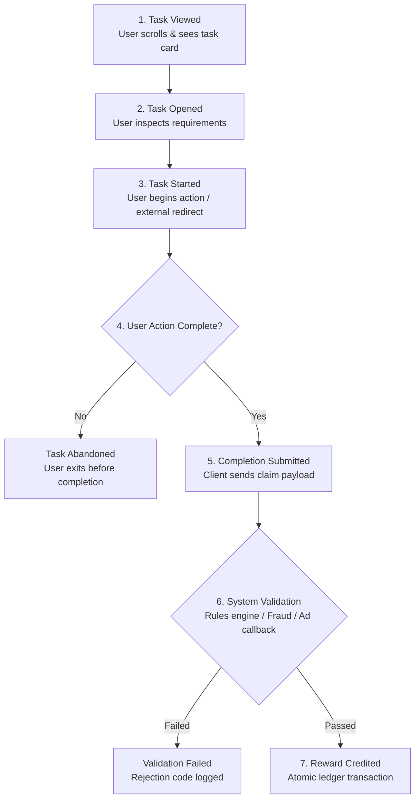
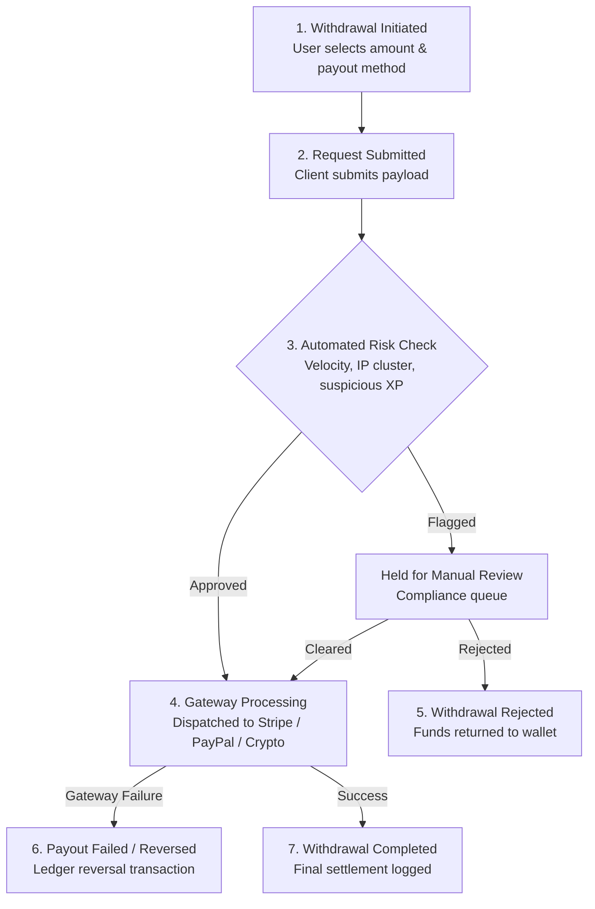
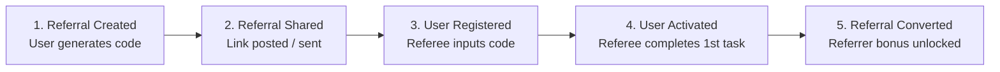
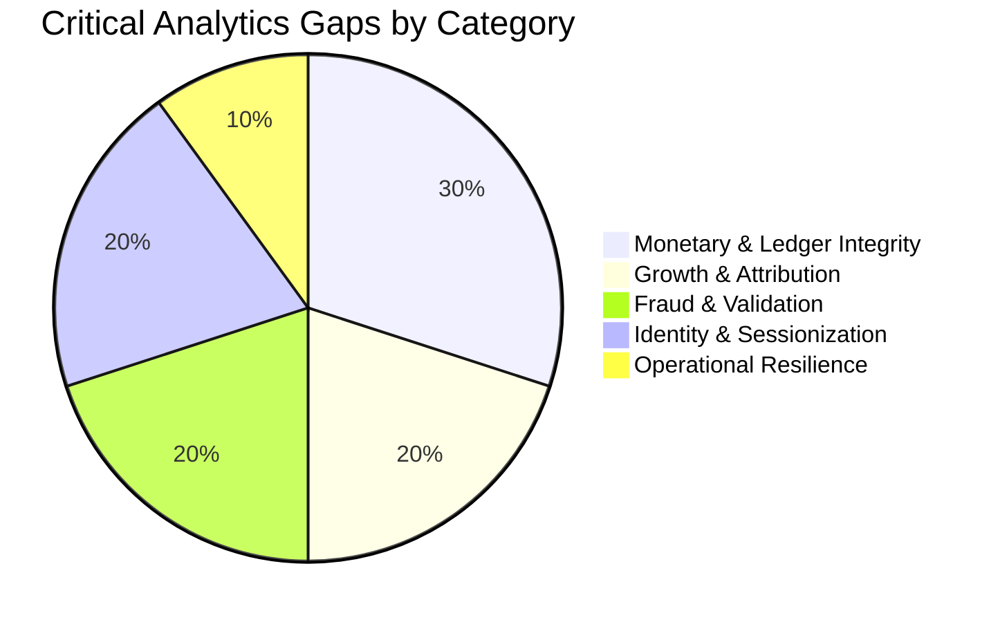

# VELOOP REWARDS — WORK PACKAGE A
## Product Data Readiness Audit & Data Coverage Matrix
**Document ID:** VELOOP-DELIV-02-03  
**Deliverables Covered:** Deliverable 02 (Product Data Audit) & Deliverable 03 (Data Coverage Matrix)  
**Classification:** SIMULATED DATA — CREATED FOR ANALYTICAL TESTING  
**Status Standard:** Confirmed | Proposed | To Be Verified  

---

### 1. Executive Summary & Audit Scope

The primary objective of the **Product Data Readiness Audit** is to evaluate the end-to-end data generation footprint across the VELOOP Rewards ecosystem. This audit maps what VELOOP currently logs within its simulated datasets against the minimum telemetry, state machines, and relational models required to operate a reliable, fraud-resistant rewards platform.

#### Key Audit Baseline:
* **Features Inspected:** 15 distinct functional modules identified in telemetry (`03_Feature_Events`, `Users_1000_Clean`, `05_Task_Activity`).
* **Audited Records:** 35,704 simulated feature events, 1,000 user profiles, 7,913 session records, and 9,846 task activities.
* **Core Finding:** While top-of-funnel engagement and UI clickstream events are simulated extensively, **downstream monetary, validation, and conversion states are largely absent or conflated into generic event strings**.

---

### 2. A1. Product Area Mapping

The following matrix maps every operational product area within VELOOP, identifying the user's action, the corresponding automated system outcome, the minimum analytical payload required, the business question addressed, and current verification status.

| Product Area | Feature / Module | User Action | System Outcome | Data Required | Business Question | Status |
|---|---|---|---|---|---|---|
| **Account & Auth** | Registration | User submits registration form / SSO | User account provisioned; verification email dispatched | `user_id`, `reg_datetime`, `source`, `platform`, `device` | Where are new users acquired from, and which acquisition channels yield active accounts? | Confirmed |
| **Account & Auth** | Login | User submits credentials / biometric auth | Session token generated; security telemetry recorded | `user_id`, `session_id`, `login_datetime`, `auth_method` | What is our true Daily Active User (DAU) count vs background refresh hits? | Confirmed |
| **Account & Auth** | Onboarding | User navigates welcome carousel & completes setup | Onboarding state flagged as completed; initial bonus unlocked | `user_id`, `step_number`, `completion_status`, `duration_sec` | Where do new users drop off during the initial 5 minutes of product experience? | Proposed |
| **Earning: Tasks** | Watch Ads | User taps ad card, views 30s rewarded video ad | Ad network callback verified; impression credited; reward allocated | `user_id`, `ad_unit_id`, `ad_network`, `duration_watched`, `reward_id` | Which ad networks deliver completed views vs high abandonment rates? | Confirmed |
| **Earning: Tasks** | Tap & Earn | User taps interactive canvas | Tap counter incremented; rate-limit / anti-autoclicker checked | `user_id`, `tap_count`, `duration_ms`, `multiplier`, `session_id` | What is the average session duration and fatigue point for micro-interaction earning? | Confirmed |
| **Earning: Tasks** | Mining Rewards | User initiates mining session timer | Cloud timer started; periodic yield accumulated; session finalized | `user_id`, `start_time`, `yield_rate`, `end_time`, `claim_status` | Does passive earning drive sustained retention or passive abandonment? | Confirmed |
| **Earning: Tasks** | Missions | User starts structured multi-step challenge | Mission progress tracked; completion validated by rules engine | `user_id`, `mission_id`, `criteria_met`, `xp_awarded`, `completion_time` | Do multi-step missions improve Day-7 and Day-30 retention cohorts? | Confirmed |
| **Earning: Tasks** | Follow & Earn | User navigates to social handle and follows | Third-party verification API pinged; status verified | `user_id`, `platform_name`, `target_account`, `verification_status` | What is the conversion efficiency and fraudulent verification rate of social tasks? | Confirmed |
| **Gamification** | Spin the Wheel | User initiates daily/rewarded lucky spin | RNG algorithm executes server-side; prize tier assigned | `user_id`, `spin_id`, `cost_type`, `reward_type`, `reward_amount` | Does spin engagement trigger subsequent core earning task completion? | Confirmed |
| **Gamification** | Daily Rewards | User claims calendar day reward | Streak evaluated; day counter updated; reward credited | `user_id`, `calendar_day`, `streak_day_count`, `reward_amount` | What proportion of users maintain unbroken 7-day reward streaks? | Confirmed |
| **Gamification** | Streak Rewards | User completes daily activity to extend streak | Streak milestone unlocked; multiplier applied to earnings | `user_id`, `current_streak`, `longest_streak`, `is_broken_flag` | At what streak length does user drop-off peak, and why? | Confirmed |
| **Gamification** | Badges & Levels | User fulfills tier requirements | XP accumulated; level tier incremented; badge minted | `user_id`, `level_number`, `badge_id`, `unlock_datetime`, `total_xp` | Does status progression correlate with lower churn rates? | Confirmed |
| **Gamification** | Leaderboard | User views global / regional ranking | Leaderboard rank calculated and served | `user_id`, `rank_position`, `cohort_id`, `view_datetime` | Does leaderboard visibility drive competitive earning re-engagement? | Confirmed |
| **Security** | CAPTCHA | User solves bot-prevention challenge | Solution evaluated server-side; risk score assigned | `user_id`, `challenge_id`, `attempt_count`, `latency_ms`, `passed_flag` | What is our true bot incidence rate across task completions? | Confirmed |
| **Monetary & Ledger** | Wallet | User views balance and transaction history | Real-time balance computed from ledger | `user_id`, `available_xp`, `token_balance`, `fiat_equivalent` | Are users actively checking wallet balance before or after withdrawal requests? | Confirmed |
| **Monetary & Ledger** | Exchange Center | User requests exchange of XP/Gems for Tokens | Ledger debit/credit applied atomically | `user_id`, `exchange_id`, `source_currency`, `dest_currency`, `rate` | What are the velocity and volume flows between secondary and primary tokens? | Proposed |
| **Monetary & Ledger** | Withdrawals | User requests payout to external gateway | Fraud checks run; hold placed; payout dispatched | `user_id`, `withdrawal_id`, `amount`, `payout_method`, `status` | What is our payout completion rate, average SLA, and rejection breakdown? | Proposed |
| **Growth** | Referral System | User shares invite link / friend enters code | Referral ledger entry created; attribution link stored | `referrer_id`, `referee_id`, `referral_code`, `channel`, `status` | What is our viral coefficient ($K$-factor) and referee activation rate? | Confirmed |
| **Support & Ops** | Help Center | User searches FAQs or submits support ticket | Ticket created; category assigned; SLA monitored | `user_id`, `ticket_id`, `category`, `resolution_time_hrs`, `status` | What product areas generate the highest volume of user complaints/confusion? | Proposed |

---

### 3. A2. User Action Flows & Measurable Stage Decomposition

To avoid superficial telemetry, each product journey must be broken down into discrete user actions and system validation gates.

#### 1. Task Earning Lifecycle (Ad, Social, Mission, Tap)

#### 2. Withdrawal & Payout Lifecycle

#### 3. Referral Conversion Funnel

---

### 4. A3. System Outcomes vs. User Events vs. Business Outcomes

A fatal flaw in novice analytics architecture is treating internal system states or business consequences as frontend user events. The table below delineates the strict boundary between these three tiers:

| Tier | Definition | Examples | Analytical Storage & Ownership |
|---|---|---|---|
| **Tier 1: User Event** | Explicit, user-initiated action on the client (frontend). Reflects user intent and friction points. | `task_viewed` `ad_started` `withdrawal_requested` `referral_link_clicked` | **Client Telemetry Stream** (`fact_feature_events`) Producer: Web / Android Client |
| **Tier 2: System Event** | Automated server-side decision, verification, or state change executed by backend logic or external webhooks. | `ad_view_verified` `fraud_risk_scored` `reward_credited` `withdrawal_processing` `account_suspended` | **Transactional Domain Event Store** (`fact_system_events`, `fact_wallet_transactions`) Producer: Backend Services, Webhooks |
| **Tier 3: Business Outcome** | Macro-level operational or financial result derived from aggregated user and system events. | Net User Retention (D7/D30) Net Revenue per User (ARPU) Withdrawal Loss Rate Viral Coefficient ($K$) | **Analytics / Semantic Layer** (Data Warehouse Views, KPI Dashboards) Producer: Analytics Engineering / dbt |

---

### 5. A4. Comprehensive Data Coverage Matrix

Below is the definitive **Data Coverage Matrix**, detailing every required operational event, data schema requirements, ownership, and priority.

| Product Area | User Action | System Action | Business Outcome | Data Required | Proposed Event Name | Source | Business Question | Status | Priority |
|---|---|---|---|---|---|---|---|---|---|
| **Account** | User signs up | Validates form & creates DB record | New Registered User | `user_id`, `timestamp`, `channel`, `device`, `country` | `user_registered` | Backend Auth | What is our customer acquisition volume by source? | Confirmed | Critical |
| **Account** | User authenticates | Issues JWT & creates session | Active Session / DAU | `user_id`, `session_id`, `timestamp`, `platform` | `user_logged_in` | Backend Auth | What is our true engagement frequency and DAU count? | Confirmed | Critical |
| **Account** | Completes setup | Sets onboarding flag to true | Onboarded User | `user_id`, `timestamp`, `duration_sec`, `step_count` | `onboarding_completed` | Frontend / Backend | What percentage of signups successfully complete onboarding? | Proposed | High |
| **Account** | Closes app / times out | Terminates active session token | Session Duration & Cohort | `user_id`, `session_id`, `duration_sec`, `exit_feature` | `session_ended` | Frontend Client | What is the average session engagement depth? | Proposed | High |
| **Tasks** | Taps task card | Queries task payload & requirements | Task Discovery / CTR | `user_id`, `task_id`, `task_type`, `category` | `task_opened` | Frontend Client | Which task types attract the highest initial interest? | Confirmed | High |
| **Tasks** | Initiates task | Sets task status to 'In Progress' | Task Intent | `user_id`, `task_id`, `task_type`, `started_at` | `task_started` | Frontend / Backend | What is the conversion rate from opening to starting a task? | Confirmed | Critical |
| **Tasks** | Submits completion | Receives proof/payload | Task Completion Rate | `user_id`, `task_id`, `completed_at`, `duration_sec` | `task_completed` | Frontend Client | What is the baseline task completion velocity? | Confirmed | Critical |
| **Tasks** | Drops out of task | Marks task abandoned | Friction / Dropout Point | `user_id`, `task_id`, `abandoned_at`, `reason` | `task_abandoned` | Frontend Client | Where do users encounter insurmountable friction? | Confirmed | High |
| **Validation** | N/A (Automated) | Validates rules & third-party proof | Clean Task Verification | `task_id`, `user_id`, `validation_status`, `ruleset_ver` | `task_validation_passed` | Backend Rules | What is our genuine vs unverified task completion rate? | Proposed | Critical |
| **Validation** | N/A (Automated) | Flags bot / invalid proof | Fraud Prevention | `task_id`, `user_id`, `failure_code`, `risk_score` | `task_validation_failed` | Backend Rules | What is our bot/fraud attack volume across tasks? | Proposed | Critical |
| **Rewards** | N/A (Automated) | Executes double-entry wallet credit | Reward Distribution | `transaction_id`, `user_id`, `amount`, `unit`, `source_id` | `reward_credited` | Backend Wallet | What is our daily liability issuance rate? | Confirmed | Critical |
| **Rewards** | N/A (Automated) | Reverses fraudulent reward | Balance Correction | `transaction_id`, `orig_tx_id`, `amount`, `reason` | `reward_reversed` | Backend Wallet | How much fraudulent reward value is successfully reclaimed? | Proposed | High |
| **Gamification** | Taps 'Claim Reward' | Increments streak counter | Day-N Retention Signal | `user_id`, `streak_day`, `reward_amount`, `timestamp` | `daily_reward_claimed` | Backend API | What percentage of active users build unbroken 7-day habits? | Confirmed | High |
| **Gamification** | Misses daily login | Resets active streak counter | Retention Churn Warning | `user_id`, `streak_lost_count`, `last_active_date` | `streak_broken` | Backend Cron | What is the churn rate immediately following a broken streak? | Confirmed | Medium |
| **Gamification** | Spins wheel | Computes RNG prize | Gamified Re-engagement | `user_id`, `spin_id`, `prize_tier`, `reward_value` | `spin_completed` | Backend API | Does gamified micro-rewarding stimulate core task adoption? | Confirmed | Medium |
| **Gamification** | Reaches XP tier | Upgrades tier & unlocks perks | User Progression | `user_id`, `new_level`, `total_lifetime_xp`, `perks` | `level_up` | Backend API | How does user level correlate with 30-day retention? | Confirmed | Medium |
| **Wallet** | Navigates to wallet | Serves ledger balance | Withdrawal Readiness | `user_id`, `xp_balance`, `token_balance`, `timestamp` | `wallet_viewed` | Frontend Client | What proportion of users check balances daily? | Confirmed | Medium |
| **Wallet** | Exchanges XP for Token | Debits XP, credits Token ledger | Internal Currency Velocity | `exchange_id`, `user_id`, `xp_debited`, `tokens_credited` | `currency_exchanged` | Backend Wallet | What is the net exchange rate and currency preference? | Proposed | High |
| **Withdrawals** | Submits payout | Places hold on balance; queues job | Liquidity Demand | `withdrawal_id`, `user_id`, `amount`, `method`, `status` | `withdrawal_requested` | Backend Wallet | What is the total monetary redemption liability demand? | Proposed | Critical |
| **Withdrawals** | N/A (Automated) | Dispatches payout payload to gateway | Gateway Latency SLA | `withdrawal_id`, `gateway_name`, `gateway_ref_id` | `withdrawal_processing` | Backend Wallet | What is our average gateway processing latency? | Proposed | High |
| **Withdrawals** | Gateway callback | Finalizes payout; updates balance | Completed Settlement | `withdrawal_id`, `final_fee`, `settlement_time`, `status` | `withdrawal_completed` | Backend Webhook | What is our net payout success rate? | Proposed | Critical |
| **Withdrawals** | Gateway failure / Ops | Rejects request; refunds ledger | Payout Failure SLA | `withdrawal_id`, `rejection_code`, `reason`, `refund_tx_id` | `withdrawal_rejected` | Backend Webhook | Why are payouts failing (invalid KYC, wrong account, risk)? | Proposed | Critical |
| **Referrals** | Shares referral code | Generates tracking deep link | Viral Organic Reach | `user_id`, `referral_code`, `channel_shared` | `referral_shared` | Frontend Client | Which social channels generate the highest sharing volume? | Confirmed | High |
| **Referrals** | Friend inputs code | Links referee to referrer | Top-of-Funnel Referral | `referral_id`, `referrer_id`, `referee_id`, `timestamp` | `referral_registered` | Backend Auth | What is the viral conversion rate of shared links to signups? | Proposed | Critical |
| **Referrals** | Referee earns 1st XP | Unlocks referrer commission | Qualified Acquisition | `referral_id`, `referrer_id`, `referee_id`, `bonus_xp` | `referral_converted` | Backend Wallet | What is our Cost Per Qualified Referee Acquisition? | Proposed | Critical |
| **Support** | Submits support query | Generates Zendesk/internal ticket | User Dissatisfaction / Bug | `ticket_id`, `user_id`, `category`, `priority` | `support_ticket_created`| Support API | What features generate the most blocking user errors? | Proposed | Medium |

---

### 6. Expected Output: Top 10 Critical Analytics Gaps

Based on rigorous cross-referencing between the simulated dataset (`VELOOP_Simulated_User_Behavior_1000.xlsx`) and production requirements, the following **10 mission-critical analytics gaps** have been identified:

#### Gap 1: Absence of a Double-Entry Transaction Ledger Table
* **Issue:** In the current simulated behavior dataset, wallet interactions are only represented as a UI event (`wallet_viewed`) or an aggregated daily counter (`wallet_activity`). There is no immutable transaction ledger table (`fact_wallet_transactions`).
* **Consequence:** Impossible to audit point-in-time user balances, calculate token velocity, perform financial reconciliation, or detect ledger drift/unauthorized balance inflation.
* **Priority:** **Critical**  
* **Remediation:** Implement a backend double-entry ledger table tracking `transaction_id`, `user_id`, `transaction_type` (Credit/Debit/Reversal/Adjustment), `amount`, `currency_unit`, `reference_id`, and `running_balance`.

#### Gap 2: Complete Absence of a Normalized Withdrawal Lifecycle Entity
* **Issue:** The dataset contains no records for withdrawal requests, processing pipelines, or payout outcomes (`fact_withdrawals`), despite withdrawal being the core value-proposition of a rewards app.
* **Consequence:** Management cannot evaluate payout SLA, gateway failure rates, rejection distributions, or outstanding liquidity liabilities.
* **Priority:** **Critical**  
* **Remediation:** Introduce a dedicated `withdrawals` table tracking the full finite state machine: `Requested -> Under Review -> Processing -> Completed / Rejected / Reversed`.

#### Gap 3: Severed Referral Attribution Linkage
* **Issue:** The `Users` table contains `referral_code` and `referral_source_detail`, but there is no relational entity mapping the referring `user_id` to the referred `user_id` and tracking conversion milestones.
* **Consequence:** VELOOP cannot calculate viral coefficient ($K$-factor), referral ROI, or identify referral fraud (e.g. self-referral farming).
* **Priority:** **Critical**  
* **Remediation:** Establish `fact_referral_conversions` with `referral_id`, `referrer_user_id`, `referee_user_id`, `attributed_code`, `registration_at`, `first_task_completed_at`, and `reward_credited_at`.

#### Gap 4: Missing Task Validation & Fraud Detection Telemetry
* **Issue:** `05_Task_Activity` only records whether a task was `Completed` or `Failed`, with rudimentary failure reasons. There is no trace of system validation events (e.g. IP velocity checks, ad callback cryptographic signatures, CAPTCHA confidence scores).
* **Consequence:** Inability to distinguish between genuine user drop-off and systematic bot exploitation; impossible to measure false-positive rates of security rules.
* **Priority:** **Critical**  
* **Remediation:** Emit structured system validation events (`task_validation_passed`, `task_validation_failed`) capturing validation rule IDs, risk scores, and third-party callback payloads.

#### Gap 5: Lack of Event Deduplication Keys & Idempotency Tokens
* **Issue:** The messy events sheet (`10_Event_Data_Quality_Audit`) revealed duplicate event rows with identical timestamps and IDs. Raw events lack client-generated idempotency keys (`client_request_uuid`).
* **Consequence:** Network retries cause double-counting of completions, duplicate reward distributions, and corrupted KPI reporting.
* **Priority:** **High**  
* **Remediation:** Enforce client-generated UUIDv4 `idempotency_key` on all mutation events and establish a deduplication window at ingestion.

#### Gap 6: Inconsistent Feature & Event Naming Standardization
* **Issue:** Audit revealed mixed-case feature names in event streams (`missions` vs `Missions`, `daily reward` vs `Daily Reward`, `watch ads` vs `Watch Ads`).
* **Consequence:** SQL aggregations with `GROUP BY feature_name` split single features into multiple distinct categories, distorting engagement reporting unless manual cleaning is performed.
* **Priority:** **High**  
* **Remediation:** Enforce strict snake_case naming conventions (`domain_object_action`) at the API gateway validation layer, rejecting non-conforming payloads.

#### Gap 7: Granular Onboarding Funnel Telemetry is Missing
* **Issue:** The user table records only a static boolean / enum `onboarding_status: Completed`. There are no intermediate step-by-step events (`onboarding_step_viewed`, `onboarding_permission_prompted`, `onboarding_skipped`).
* **Consequence:** Product teams cannot pinpoint where during the critical first 3 minutes new users experience cognitive overload or churn.
* **Priority:** **High**  
* **Remediation:** Instrument granular onboarding step events with sequence indices and duration-per-step tracking.

#### Gap 8: Conflation of "Activity Occurred" with "Reward Credited"
* **Issue:** In several task events, completion is assumed to immediately equal reward distribution. However, asynchronous ad networks and affiliate task walls frequently delay, reject, or claw back payouts.
* **Consequence:** Financial discrepancies between operational activity volume and true balance liability.
* **Priority:** **High**  
* **Remediation:** Explicitly decouple client action telemetry (`task_completed`) from backend accounting events (`reward_credited`, `reward_pending`, `reward_reversed`).

#### Gap 9: Raw Storage of Unsanitized PII in Analytical Layers
* **Issue:** The clean user table stores raw `full_name` and `email` alongside analytical metrics without pseudonymization or data classification tags.
* **Consequence:** Severe compliance and data privacy exposure (GDPR / DPDP Act violation) if analyst workspaces access unmasked personally identifiable data.
* **Priority:** **High**  
* **Remediation:** Mask/hash PII in the analytics layer, exposing only synthetic `user_id` and hashed identifiers to BI and analytics environments.

#### Gap 10: Missing Session Timeout & Heartbeat Instrumentation
* **Issue:** `02_Sessions` provides `session_start` and `session_end`, but lacks periodic heartbeat pings or foreground/background state indicators.
* **Consequence:** Inability to distinguish between users actively engaging with the UI vs users leaving the application open in a background tab or suspended mobile state.
* **Priority:** **Medium**  
* **Remediation:** Implement 30-second client heartbeat telemetry and explicit `app_backgrounded` / `app_foregrounded` state events.
