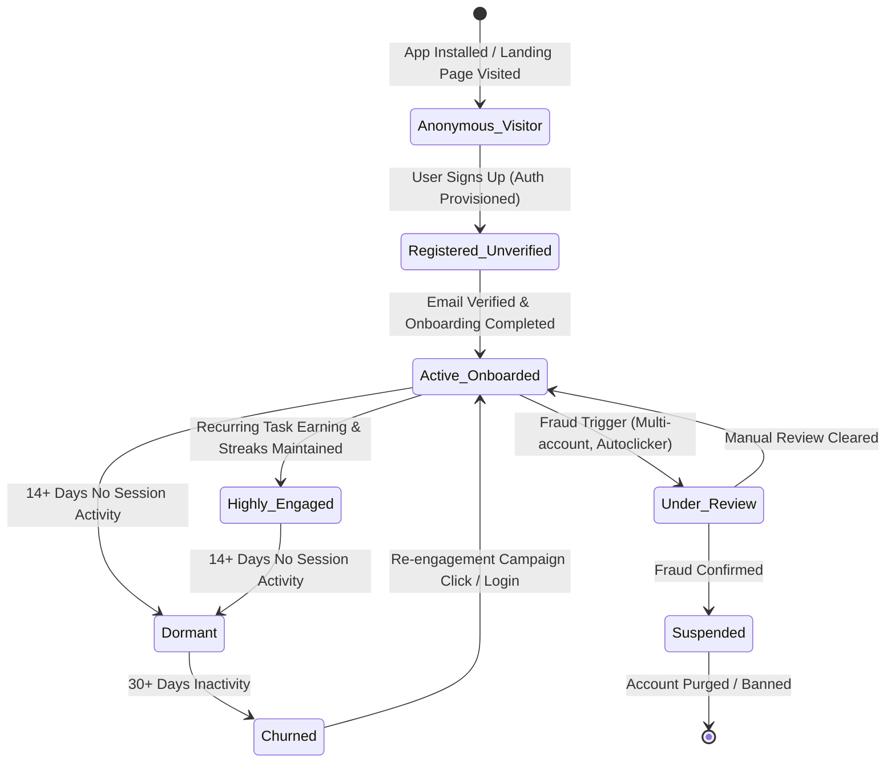
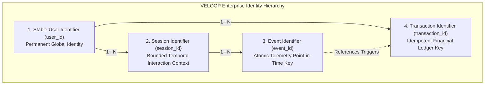

# VELOOP REWARDS — WORK PACKAGE B
## User & Account Analytics Specification
**Document ID:** VELOOP-DELIV-04  
**Deliverable Covered:** Deliverable 04 (User Analytics Specification & Identity Requirements)  
**Classification:** SIMULATED DATA — CREATED FOR ANALYTICAL TESTING  
**Status Standard:** Confirmed | Proposed | To Be Verified  

---

### 1. Objective & Scope

Understanding the end-to-end user lifecycle is the foundational pillar of product intelligence. This specification outlines the complete data contract for **User Identity, Authentication, Onboarding, and Account State Transitions** across VELOOP Rewards. 

In strict adherence to **Privacy-by-Design** and the **VELOOP Non-Negotiable Integrity Rules**, this specification decouples personal identity (PII) from analytical dimensions, ensuring that data analysts and BI systems operate exclusively on sanitized, pseudonymous identifiers and behavioral attributes.

---

### 2. User Lifecycle Architecture

The VELOOP user journey is modeled as a five-stage progressive state machine:

#### Detailed Lifecycle Phases:

1. **Acquisition & Registration:**
   * User registers via Web, Android, or iOS client.
   * Telemetry captures acquisition channel (Organic, Referral, Paid Ads, Social Campaign), campaign parameters (UTM parameters, referral codes), and device fingerprinting metadata.
2. **Authentication & Session Inception:**
   * Each user interaction occurs within a cryptographically isolated session token.
   * Auth logs record login method (Email/Password, Google SSO, Apple Sign-In), client version, IP subnet, and device security indicators.
3. **Onboarding & First-Mile Milestones:**
   * Tracks user progression through tutorial cards, notification permission requests, and first earning task discovery.
   * Measures time-to-first-value ($TTFV$): duration from account creation to first rewarded event.
4. **Active Engagement & Account State Transitions:**
   * Dynamic account status evaluation: `Pending Verification -> Active -> Dormant -> Suspended`.
   * Real-time calculation of activity recency, frequency, and monetary progression (XP, Gems, Tokens).

---

### 3. B1. User Identity Requirements

To build a robust, scalable analytical data lake, VELOOP requires four distinct, non-conflated tiers of identifiers. Each identifier serves a distinct mathematical, deduplication, and architectural purpose.

#### Detailed Identifier Specifications:

#### 1. Stable User Identifier (`user_id`)
* **Format:** UUID v4 or prefixed alphanumeric string (e.g., `VLUSR000001` in simulated data; standardizing to UUID v4 in production target `usr_7f8c12e4-6a8b-4b11-9f93-018263549210`).
* **Generation Engine:** Backend Authentication Service (Primary Key of `dim_users`).
* **Why It Is Needed:**
  * Serves as the single immutable anchor connecting all user actions across devices, platforms, web views, and mobile sessions.
  * Ensures that profile updates (e.g. email change, username change) do not sever historical behavioral longitudinal analysis or retention cohort tracking.
* **Integrity Rule:** Must never change over the user's lifetime; must never contain unmasked PII (phone number, raw email).

#### 2. Session Identifier (`session_id`)
* **Format:** Unique alphanumeric string (e.g., `SESS0000001` in simulated data; target format `ses_<user_id_prefix>_<timestamp_epoch>_<random_hex>`).
* **Generation Engine:** Frontend SDK / API Gateway at session inception.
* **Why It Is Needed:**
  * Defines the bounded temporal window of continuous user engagement.
  * Allows calculation of critical product metrics: session duration, events per session, feature traversal paths, and bounce rates.
  * Decouples raw event volume from engagement frequency (e.g. 50 events across 1 session vs 50 events across 10 distinct sessions).
* **Session Boundary Rules:**
  * **Inactivity Timeout:** 30 minutes of client inactivity closes the session.
  * **Midnight Rollover:** A session crossing midnight (00:00 UTC) is closed and a new session spawned to ensure accurate Daily Active User (DAU) reporting.

#### 3. Event Identifier (`event_id`)
* **Format:** Globally Unique Identifier (e.g., `EVT00000001` in simulated data; target format ULID: Universally Unique Lexicographically Sortable Identifier).
* **Generation Engine:** Client Analytics SDK at telemetry emission point.
* **Why It Is Needed:**
  * Provides atomic point-in-time identification for every logged interaction.
  * Guarantees **idempotent ingestion** and deduplication: network retries or client buffering flushes that resend the same event payload will not cause duplicate event counts in BigQuery/Snowflake.
  * Enables chronological ordering across distributed systems with sub-millisecond precision.

#### 4. Transaction Identifier (`transaction_id`)
* **Format:** High-entropy cryptographic string (target format `tx_wall_<timestamp>_<uuid>`).
* **Generation Engine:** Backend Wallet Service / Ledger Engine.
* **Why It Is Needed:**
  * Required for strict **double-entry ledger accounting** and financial auditability.
  * Distinguishes client telemetry (`event_id: task_completed`) from backend balance mutation (`transaction_id: tx_12345`).
  * Enables zero-loss reconciliation, rollback traceability, dispute resolution, and audit trail validation for every balance credit, debit, or clawback.

---

### 4. B2. User Analytics Specification Table

The following specification details every core analytical field required in the user dimension (`dim_users`). In accordance with data minimization best practices, **no unnecessary personal data is requested**.

| Field Name | Data Type | Required? | Purpose | Source | Validation Rules | Status |
|---|---|---|---|---|---|---|
| `user_id` | String (UUID) | Yes | Stable primary key anchoring all user data | Backend Auth | Unique; non-null; regex: `^usr_[a-zA-Z0-9_\-]+$` | Confirmed |
| `registration_datetime` | Timestamp (UTC) | Yes | Cohort grouping (D1/D7/D30 retention baselines) | Backend Auth | Valid ISO 8601 UTC timestamp; $\le \text{Current Time}$ | Confirmed |
| `registration_channel` | String | Yes | High-level acquisition source attribution | Frontend SDK / Auth | Allowed values: `Organic`, `Referral`, `Paid Ads`, `Social`, `Direct` | Confirmed |
| `acquisition_campaign` | String | No | Marketing campaign tracking | URL params / Branch SDK | Nullable; sanitized string (max 100 chars); no URL fragments | Proposed |
| `referral_code_used` | String | No | Referral attribution link | Auth Registration Payload| Must match existing `referral_code` in system; nullable | Confirmed |
| `primary_platform` | String | Yes | Platform slice for operational health | Client User Agent / App | Allowed values: `Android`, `iOS`, `Web` | Confirmed |
| `primary_device_category` | String | Yes | Hardware profiling for crash and UX analysis | Client Hardware Telemetry| Allowed values: `Mobile`, `Tablet`, `Desktop` | Confirmed |
| `client_version_at_reg` | String | Yes | App release version monitoring | Client Build Config | Semantic versioning format: `^v?[0-9]+\.[0-9]+\.[0-9]+$` | Proposed |
| `geo_country_code` | String | Yes | Macro geographic segmentation | IP Geo Lookup (MaxMind) | ISO 3166-1 alpha-2 (2 uppercase letters e.g. `IN`, `US`) | Confirmed |
| `geo_region_state` | String | No | Regional targeting and localization | IP Geo Lookup (MaxMind) | Clean string; trimmed; no special characters | Confirmed |
| `account_status` | String | Yes | Current lifecycle state | Backend Account Service | Allowed values: `Active`, `Inactive`, `Suspended`, `Pending Verification` | Confirmed |
| `email_verified_flag` | Boolean | Yes | Trust & bot prevention metric | Auth Service | Boolean (`true` / `false`) | Confirmed |
| `onboarding_status` | String | Yes | Activation funnel evaluation | Onboarding Service | Allowed values: `Not Started`, `In Progress`, `Completed`, `Skipped` | Confirmed |
| `onboarding_completed_at`| Timestamp (UTC) | No | Time-to-onboard calculation | Onboarding Service | Nullable; $\ge \text{registration\_datetime}$ | Proposed |
| `last_login_datetime` | Timestamp (UTC) | No | Recency and churn calculation | Auth Service | Nullable; $\ge \text{registration\_datetime}$ | Confirmed |
| `days_since_registration`| Decimal | Yes | Age of user account in days | Derived (Analytical Layer) | Float $\ge 0.0$ | Confirmed |
| `lifetime_sessions_count`| Integer | Yes | Engagement depth metric | Derived Rollup | Integer $\ge 0$ | Confirmed |
| `total_active_days` | Integer | Yes | Frequency metric (L14/L30 engagement) | Derived Rollup | Integer $\ge 0$; $\le \text{days\_since\_registration}$ | Confirmed |
| `current_xp_balance` | Integer | Yes | Point-in-time gamification progression | Wallet Ledger Rollup | Integer $\ge 0$ | Confirmed |
| `current_token_balance` | Decimal | Yes | Point-in-time monetary liability | Wallet Ledger Rollup | Decimal(18,4) $\ge 0.0000$ | Proposed |
| `is_active_7d_flag` | Boolean | Yes | WAU (Weekly Active User) reporting flag | Derived Rollup | Boolean (`true` / `false`) | Confirmed |
| `is_active_30d_flag` | Boolean | Yes | MAU (Monthly Active User) reporting flag | Derived Rollup | Boolean (`true` / `false`) | Confirmed |
| `consent_privacy_policy` | Boolean | Yes | Regulatory compliance verification (GDPR/DPDP)| Consent Modal | Must be `true` for active accounts | Confirmed |
| `marketing_opt_in` | Boolean | Yes | Push / Email deliverability segment | User Settings | Boolean (`true` / `false`) | Confirmed |
| `fraud_risk_score` | Decimal | No | Risk classification for withdrawal throttling | Security Service | Float range: `0.00` to `100.00` | Proposed |

---

### 5. Privacy & Data Minimization Protocol

#### Excluded Sensitive PII:
To ensure uncompromising compliance with data protection regulations, the following attributes are **prohibited** from being ingested into or retained within the analytical data warehouse:
* ❌ **Passwords & Credentials:** Passwords, salt hashes, and session secrets are strictly retained in the identity provider's encrypted store and never mirrored to analytics.
* ❌ **Full Name & Raw Contact Info:** Direct names (`full_name`) and plaintext phone numbers are excluded. Where communication is required, internal CRM connectors reference `user_id` without exposing raw contact details to analysts.
* ❌ **Raw Email:** Replaced in analytical tables by `email_domain` (e.g., `gmail.com`, `yahoo.com`) for demographic analysis and `email_sha256_hash` for cross-platform identity resolution without PII exposure.
* ❌ **Financial PII:** Bank account numbers, PayPal passwords, UPI IDs, and crypto private keys are completely isolated within third-party payment gateway vault tokens (e.g. Stripe Customer ID, Cashfree Token). Only gateway reference tokens are stored.

---

### 6. Verification & Implementation Backlog Notes

* **Verification Item (V-B01):** Verify with backend engineering whether `last_login_datetime` is currently updated synchronously upon JWT issuance or batched via an asynchronous Redis cache flush (`Status: To Be Verified`).
* **Verification Item (V-B02):** Confirm whether client SDK automatically injects `session_id` into HTTP request headers or if session synthesis currently relies on client-side timestamps (`Status: To Be Verified`).
