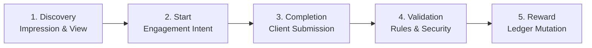
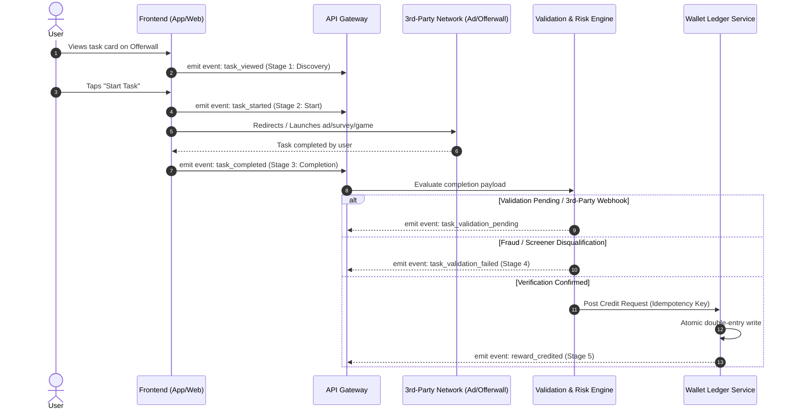
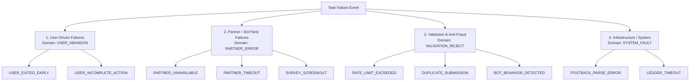
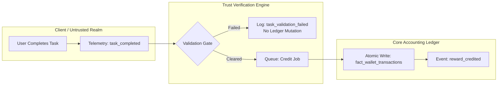

# VELOOP REWARDS — WORK PACKAGE C
## Earning & Reward Analytics Specification
**Document ID:** VELOOP-DELIV-05  
**Deliverable Covered:** Deliverable 05 (Earning & Reward Analytics Specification)  
**Classification:** SIMULATED DATA — CREATED FOR ANALYTICAL TESTING  
**Status Standard:** Confirmed | Proposed | To Be Verified  

---

### 1. Executive Context & Objective

The core value proposition of VELOOP Rewards is user engagement through monetizable micro-tasks, gamified actions, and sponsored activities. To optimize unit economics, combat automated bot fraud, and maintain user trust, VELOOP requires a deterministic, end-to-end framework for measuring earning activity.

This specification designs the **Analytical Earning Lifecycle**, establishes **Task-Level Schema Standards**, formulates a **Structured Failure Taxonomy**, and delineates the boundary between client-side task completion and backend balance credit.

---

### 2. The 5-Stage Analytical Earning Lifecycle

Every earning interaction across VELOOP flows through five sequential, measurable stages:

#### Detailed Stage Instrumentation & Metrics:

1. **Stage 1 — Discovery (`task_viewed`):**
   * **Definition:** The user encounters an available task card on screen (viewport threshold $\ge 50\%$ for $\ge 1.0\text{s}$).
   * **Telemetry Needed:** `task_id`, `task_category`, `offerwall_provider`, `expected_reward_amount`, `reward_unit`.
   * **Primary Metric:** Task Impression Volume and Click-Through Rate ($CTR = \frac{\text{task\_opened}}{\text{task\_viewed}}$).
2. **Stage 2 — Start (`task_started`):**
   * **Definition:** The user explicitly initiates the task (taps CTA, opens survey, begins video ad, launches game).
   * **Telemetry Needed:** `task_id`, `session_id`, `task_started_at`, `client_timestamp`.
   * **Primary Metric:** Start Conversion Rate ($SCR = \frac{\text{task\_started}}{\text{task\_opened}}$).
3. **Stage 3 — Completion (`task_completed`):**
   * **Definition:** The client reports that the required user action has concluded (video finished, survey submitted, social action executed).
   * **Telemetry Needed:** `task_id`, `task_completed_at`, `duration_seconds`, `client_proof_token`.
   * **Primary Metric:** Task Completion Rate ($TCR = \frac{\text{task\_completed}}{\text{task\_started}}$) and Task Velocity ($T_{completion} - T_{start}$).
4. **Stage 4 — Validation (`task_validation_passed` / `failed`):**
   * **Definition:** Backend rules engine or third-party server-to-server (S2S) postback verifies the legitimacy of the completion.
   * **Telemetry Needed:** `task_id`, `validation_rule_id`, `risk_score`, `failure_reason_code`, `s2s_callback_id`.
   * **Primary Metric:** Validation Pass Rate ($VPR = \frac{\text{validations\_passed}}{\text{tasks\_completed}}$).
5. **Stage 5 — Reward (`reward_credited`):**
   * **Definition:** Atomic financial write to the user's ledger crediting the promised unit (XP, Gems, Tokens).
   * **Telemetry Needed:** `transaction_id`, `user_id`, `amount`, `unit`, `ledger_timestamp`.
   * **Primary Metric:** Reward Settlement Rate ($RSR = \frac{\text{rewards\_credited}}{\text{validations\_passed}}$) and Settlement Latency ($T_{reward} - T_{completion}$).

---

### 3. C1. Task-Level Analytics Specification

Based on empirical analysis of `05_Task_Activity` (9,846 records across 8 categories: *Advertisement, App Task, Survey, CAPTCHA, Social Activity, Game, Mission, Promotional Task*), the target analytical model (`fact_task_activity`) must capture the following standardized schema:

| Field Name | Data Type | Required? | Description & Allowed Values | Source | Validation Standard | Status |
|---|---|---|---|---|---|---|
| `activity_id` | String | Yes | Unique task attempt identifier (`ACT...`) | Client SDK | Unique; regex: `^ACT[0-9]{7}$` | Confirmed |
| `user_id` | String | Yes | Unique user identifier | Auth Session | Must exist in `dim_users` | Confirmed |
| `task_id` | String | Yes | Specific task definition ID (`TASK0071`) | Task Catalog | Foreign key to `dim_tasks` | Confirmed |
| `task_category` | String | Yes | Classification: `Advertisement`, `App Task`, `Survey`, `CAPTCHA`, `Social Activity`, `Game`, `Mission`, `Promotional Task` | Task Engine | Strict whitelist enum | Confirmed |
| `task_viewed_at` | Timestamp | Yes | Time when user first viewed task card | Client SDK | ISO 8601 UTC timestamp | Confirmed |
| `task_started_at` | Timestamp | Yes | Time when user clicked start CTA | Client SDK | $\ge \text{task\_viewed\_at}$ | Confirmed |
| `task_completed_at` | Timestamp | No | Time when user concluded task action | Client SDK | Nullable; $\ge \text{task\_started\_at}$ | Confirmed |
| `task_duration_seconds`| Integer | No | Derived duration ($\text{completed} - \text{started}$) | Derived / SDK | $\ge 0$; Null if incomplete | Proposed |
| `task_status` | String | Yes | State: `Completed`, `Abandoned`, `Failed`, `Pending` | Task Engine | Whitelist enum | Confirmed |
| `failure_reason` | String | No | Root cause for failed/abandoned task | Rules / Partner | Nullable; whitelisted enum | Confirmed |
| `validation_status` | String | Yes | Server validation state: `Pending`, `Passed`, `Failed` | Backend Rules | Default: `Pending` | Proposed |
| `reward_status` | String | Yes | Accounting status: `Credited`, `Not Credited`, `Pending` | Wallet Service | Whitelist enum | Confirmed |
| `reward_amount` | Decimal | Yes | Quantified value awarded to user | Task Catalog | Numeric $\ge 0.00$; non-null | Proposed |
| `reward_unit` | String | Yes | Unit awarded: `XP`, `Gems`, `Tokens` | Task Catalog | Whitelist: `XP`, `GEMS`, `TOKENS` | Proposed |
| `partner_network_id` | String | No | External provider: `AdMob`, `Unity`, `BitLabs`, `CPALead` | Offerwall SDK | Whitelist or `internal` | Proposed |
| `session_id` | String | Yes | Session in which task was performed | Client Session | Foreign key to `dim_sessions` | Confirmed |
| `device` | String | Yes | Client device platform (`Android`, `iOS`, `Web`) | Client User-Agent| Matches session platform | Confirmed |

> [!WARNING]
> **Data Grounding Note:**
> In the simulated dataset (`05_Task_Activity`), fields `reward_amount`, `reward_unit`, `task_duration_seconds`, and `partner_network_id` were omitted. These are classified as **Proposed** requirements mandatory for production accounting.

---

### 4. C2. Structured Failure Taxonomy (`Proposed`)

In the simulated data, failures are represented with informal strings (*"Validation failed", "Task unavailable", "Timeout", "Incomplete action", "User exited"*). In a production ecosystem, ambiguous strings must be replaced by a structured, machine-parsable hierarchical classification.

#### Standard Failure Classification Matrix:

| Error Code | Error Category | Root Cause Description | Detection Logic | Analytical Attribution | Status |
|---|---|---|---|---|---|
| `USR_EXIT_BEFORE_END` | User Abandonment | User backed out before ad completed or survey submitted | Client view dismissed before callback | UX friction / Task fatigue | Proposed |
| `USR_INCOMPLETE_STEPS` | User Abandonment | User performed part of multi-step task and stopped | Step index $< \text{total\_steps}$ upon exit | Task complexity too high | Proposed |
| `PRT_SRV_UNAVAILABLE` | Partner Dependency | Third-party offerwall or ad unit failed to load | HTTP 5xx or empty ad inventory response | Network fill-rate drop | Proposed |
| `PRT_SRV_SCREENOUT` | Partner Dependency | User disqualified from survey based on demographic screener | Partner postback status `disqualified` | Targeting mismatch | Proposed |
| `PRT_POSTBACK_TIMEOUT` | Partner Dependency | S2S callback not received within SLA window ($\ge 60\text{min}$) | No webhook after client `task_completed` | External tracking failure | Proposed |
| `VAL_AUTOCLICK_DETECT` | Fraud / Security | Mechanical micro-timing detected in tap/earning stream | Inter-tap interval variance $< 5\text{ms}$ | Bot / Autoclicker abuse | Proposed |
| `VAL_GEO_IP_MISMATCH` | Fraud / Security | Client IP geolocation contradicts task availability zone | IP MaxMind check $\ne$ Task Region | VPN / Proxy abuse | Proposed |
| `VAL_DUPLICATE_ATTEMPT` | Fraud / Security | Task attempted multiple times within cooldown window | `user_id` + `task_id` within cooldown | Policy violation | Proposed |
| `SYS_LEDGER_TIMEOUT` | System Fault | Database connection failure during wallet credit write | ACID commit timeout $\ge 5000\text{ms}$ | Infrastructure bottleneck | Proposed |

---

### 5. C3. Decoupling "Activity Occurred" from "Reward Credited"

A fundamental principle of financial and product data integrity is that **user action telemetry must never be conflated with balance mutation**.

#### The Distinction:
* **`task_completed` is a Behavioral Event:** It records that a user performed an action on a client device at time $T$. It carries zero balance value and implies no immediate financial liability.
* **`reward_credited` is an Accounting Transaction:** It represents an immutable, double-entry financial ledger entry executed by the core ledger service at time $T + \Delta t$, incrementing the company's liability to the user.

#### Reward Event Specification:

1. **`reward_credited` (Confirmed / In Telemetry):**
   * **Trigger:** Ledger successfully writes positive balance transaction to user account.
   * **Properties:** `transaction_id`, `user_id`, `amount`, `unit`, `source_feature`, `activity_id`, `timestamp`.
2. **`reward_pending` (Proposed):**
   * **Trigger:** Task completion verified, but reward held in escrow pending third-party network clearing (e.g. 24-hour hold for high-value app installs).
   * **Properties:** `escrow_id`, `user_id`, `amount`, `unit`, `release_expected_at`, `hold_reason`.
3. **`reward_reversed` (Proposed):**
   * **Trigger:** Partner network claws back offer payout due to chargeback, attribution fraud, or survey falsification.
   * **Properties:** `reversal_tx_id`, `orig_transaction_id`, `user_id`, `amount_deducted`, `clawback_reason`.
4. **`reward_corrected` (Proposed):**
   * **Trigger:** Customer support or automated reconciliation adjusts an incorrect reward distribution.
   * **Properties:** `correction_tx_id`, `user_id`, `net_adjustment_amount`, `ticket_id`, `authorized_by`.

---

### 6. C4. Third-Party Dependencies & Asynchronous Postbacks

VELOOP relies on external partners for ads (Google AdMob, Unity Ads), surveys (BitLabs, InBrain), and offerwalls (Tapjoy, CPALead). Analytics must accommodate external failure modes.

#### Critical Third-Party Data Realities:
1. **Asynchronous S2S Latency:** 
   * Client completes action at $T_0$.
   * Partner webhook arrives at $T_0 + 45\text{min}$ (or up to 72 hours for multi-stage app install tasks).
   * **Analytics Requirement:** Telemetry must store both `client_completion_timestamp` and `server_callback_timestamp` to evaluate partner postback SLA.
2. **Reconciliation & Unattributed Events:**
   * If a user installs an app but the partner tracking link breaks, the user contacts support claiming completion.
   * **Analytics Requirement:** All task start clicks must append a cryptographically signed `sub_id` (`{user_id}_{session_id}_{activity_id}`) to the redirect URL, enabling deterministic matching when postbacks arrive.
3. **Third-Party Clawbacks & Deductions:**
   * Ad networks adjust billable impressions at end-of-month based on invalid traffic (IVT) audits.
   * **Analytics Requirement:** The ledger must support post-facto negative adjustments without corrupting historical daily event records.
