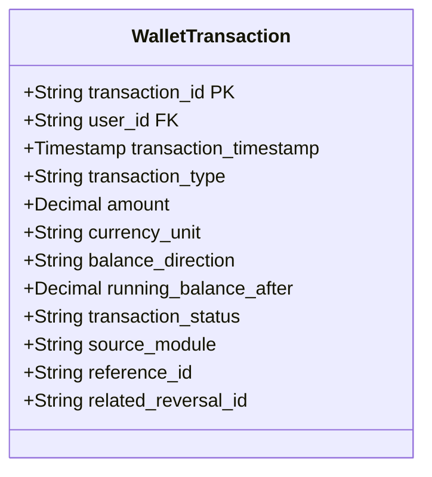

# VELOOP REWARDS — WORK PACKAGE D
## Wallet & Withdrawal Analytics Specification
**Document ID:** VELOOP-DELIV-06  
**Deliverable Covered:** Deliverable 06 (Wallet & Withdrawal Analytics Specification)  
**Classification:** SIMULATED DATA — CREATED FOR ANALYTICAL TESTING  
**Status Standard:** Confirmed | Proposed | To Be Verified  

---

### 1. Executive Context & Objective

Monetary integrity is the critical trust backbone of any rewards ecosystem. Users perform earning tasks with the expectation that their accumulated reward units (XP, Gems, Tokens) can be securely stored, exchanged, and withdrawn to real-world payment instruments (PayPal, Bank Transfer, UPI, Crypto, Gift Cards).

As established in **Work Package A (Gap #1 & Gap #2)**, the current simulated behavior dataset only tracks superficial UI events (`wallet_viewed`, `exchange_viewed`) and binary daily flags (`wallet_activity`). It completely lacks a financial ledger and a normalized withdrawal tracking entity.

This specification designs:
1. An immutable **Double-Entry Wallet Transaction Model** (`fact_wallet_transactions`).
2. A finite state machine for the **Withdrawal Lifecycle** (`fact_withdrawals`).
3. Standardized, reproducible definitions for **10 Core Withdrawal KPIs**.

---

### 2. D1. Wallet Transaction Model

To guarantee financial auditability, zero-loss reconciliation, and fraud traceability, all balance mutations must be logged to an append-only double-entry transaction ledger.

#### Detailed Transaction Schema Specification:

| Field Name | Data Type | Required? | Definition & Allowed Values | Source Engine | Validation Rule | Status |
|---|---|---|---|---|---|---|
| `transaction_id` | String | Yes | Unique immutable ledger transaction ID (`tx_wall_...`) | Wallet Core Engine | Unique PK; non-null; UUIDv4 or ULID | Proposed |
| `user_id` | String | Yes | Unique identifier of account holder | Auth Service | Foreign key to `dim_users` | Confirmed |
| `transaction_timestamp`| Timestamp | Yes | Atomic time of ledger commit (UTC) | Database Clock | ISO 8601 UTC timestamp; $\le \text{Current Time}$ | Proposed |
| `transaction_type` | String | Yes | Functional business classification: Whitelist below | Business Logic | Strict whitelist enum | Proposed |
| `amount` | Decimal(18,4)| Yes | Quantified value of balance mutation | Ledger Engine | Strict positive value ($> 0.0000$) | Proposed |
| `currency_unit` | String | Yes | Unit mutated: `XP`, `GEMS`, `TOKENS`, `FIAT_USD` | Ledger Engine | Strict whitelist enum | Proposed |
| `balance_direction` | String | Yes | Direction of balance shift: `CREDIT` (+) or `DEBIT` (-) | Ledger Engine | Allowed values: `CREDIT`, `DEBIT` | Proposed |
| `running_balance_after`| Decimal(18,4)| Yes | Verified account balance immediately after commit | Ledger Engine | Must equal $\text{prev\_bal} \pm \text{amount}$ | Proposed |
| `transaction_status` | String | Yes | Settlement state: `COMPLETED`, `PENDING`, `REVERSED` | Ledger Engine | Allowed values: `COMPLETED`, `PENDING`, `REVERSED` | Proposed |
| `source_module` | String | Yes | Originating feature: `WATCH_ADS`, `SURVEY`, `SPIN`, `WITHDRAWAL`, `REFERRAL`, `EXCHANGE` | Routing Service | Foreign key to product area | Proposed |
| `reference_id` | String | Yes | Traceable entity link (`activity_id`, `withdrawal_id`, `exchange_id`) | Client / Service | Traceable across upstream entities | Proposed |
| `related_reversal_id`| String | No | If reversed/adjusted, points to original `transaction_id` | Audit Engine | Nullable; references valid `transaction_id` | Proposed |

#### Standardized Transaction Types:

1. **`REWARD_CREDIT` (Proposed):** Balance increment derived from successful earning activity (Ad, Task, Streak, Spin, Referral Bonus).
2. **`REDEMPTION` (Proposed):** Balance debit initiated by user to fund an external withdrawal or internal purchase.
3. **`EXCHANGE_CONVERSION` (Proposed):** Paired debit/credit atomic transaction swapping one internal currency for another (e.g. debiting 1,000 XP and crediting 10 Tokens).
4. **`REVERSAL` (Proposed):** Compensating transaction clawing back an invalid, fraudulent, or refunded transaction.
5. **`ADMIN_ADJUSTMENT` (Proposed):** Manual credit/debit applied by customer operations to resolve disputes or system glitches, requiring an approved support ticket reference.

---

### 3. D2. Withdrawal Lifecycle Architecture

A withdrawal represents a real-world financial liability settlement. It must be modeled as a strict, finite state machine tracking every transition, automated gate, and gateway callback.

```mermaid
stateDiagram-v2
    [*] --> Requested : User submits payout form
    Requested --> Under_Review : Automated Risk Engine flags for manual check
    Requested --> Processing : Automated Risk Check passed
    Under_Review --> Processing : Compliance/Ops analyst approves
    Under_Review --> Rejected : Compliance rejects (KYC / Fraud / Abuse)
    Processing --> Completed : Gateway webhook confirms fund settlement
    Processing --> Reversed : Gateway payout fails / Bank bounce
    Rejected --> [*] : Hold released; funds refunded to wallet
    Reversed --> [*] : Compensating ledger credit applied
    Completed --> [*] : Terminal successful state
```

#### Detailed Lifecycle Transitions:
1. **`Withdrawal Requested`:** User initiates payout. The requested amount is immediately debited from available balance and placed into an escrow hold to prevent double-spending.
2. **`Under Review`:** High-value payouts, rapid velocity triggers, or accounts with elevated risk scores ($\ge 75.0$) are routed to an internal operations dashboard.
3. **`Processing`:** The payout payload is formatted and dispatched via API to the third-party payout provider (Stripe, PayPal, Cashfree, Crypto RPC node).
4. **`Completed`:** Asynchronous webhook from payout provider confirms that funds successfully settled into the beneficiary account.
5. **`Rejected`:** Request terminated prior to gateway dispatch due to suspicious activity, invalid payout details, or compliance sanctions. Escrow funds returned to user wallet.
6. **`Reversed`:** External banking network or gateway rejects transfer post-dispatch (e.g. closed bank account, invalid routing code). Escrow hold converted into a formal `REVERSAL` ledger credit.

#### Analytical Withdrawal Entity Schema (`fact_withdrawals`):

| Attribute | Data Type | Nullable? | Description | Source | Status |
|---|---|---|---|---|---|
| `withdrawal_id` | String (PK) | No | Unique withdrawal identifier (`WD_...`) | Backend Wallet | Proposed |
| `user_id` | String (FK) | No | Account owner | Auth Session | Confirmed |
| `requested_amount` | Decimal(10,2)| No | Gross amount requested | Client Payload | Proposed |
| `payout_currency` | String | No | Target fiat currency (`USD`, `INR`, `EUR`) | Client Payload | Proposed |
| `tokens_debited` | Decimal(18,4)| No | Quantity of platform tokens debited | Wallet Ledger | Proposed |
| `payout_method` | String | No | Gateway: `PAYPAL`, `BANK_TRANSFER`, `UPI`, `CRYPTO_USDT`, `GIFT_CARD` | User Selection | Proposed |
| `payout_gateway` | String | No | Processing vendor (`Stripe`, `PayPal`, `Cashfree`) | Payout Engine | Proposed |
| `destination_hash` | String | No | SHA-256 hash of destination (bank account, email, address) | Payout Engine | Proposed |
| `status` | String | No | Current state: `REQUESTED`, `UNDER_REVIEW`, `PROCESSING`, `COMPLETED`, `REJECTED`, `REVERSED` | State Machine | Proposed |
| `requested_timestamp` | Timestamp | No | Time user clicked confirm (UTC) | Client Gateway | Proposed |
| `review_completed_at` | Timestamp | Yes | Time ops analyst cleared review | Ops Queue | Proposed |
| `processing_started_at`| Timestamp | Yes | Time payload dispatched to gateway | Gateway Router | Proposed |
| `settlement_timestamp` | Timestamp | Yes | Time gateway confirmed final settlement | Gateway Webhook | Proposed |
| `final_processing_fee`| Decimal(10,2)| No | Network/gateway transaction fee absorbed | Gateway Webhook | Proposed |
| `reason_category` | String | Yes | Classification if rejected/reversed: `INVALID_DETAILS`, `FRAUD_SUSPICION`, `GATEWAY_ERROR`, `USER_CANCELLED` | Ops / Webhook | Proposed |

---

### 4. D3. Withdrawal Key Performance Indicators (KPIs)

In strict accordance with the assignment guidelines:
* **No fictional company targets are invented** (e.g., *"VELOOP should achieve 99% payout rate"*).
* Every metric contains an unambiguous, mathematically reproducible formula, source mappings, operational frequency, stakeholder ownership, and structural limitations.

---

#### KPI 01: Total Withdrawal Request Volume & Count
* **Definition:** Total gross monetary volume and aggregate count of withdrawal requests submitted within a defined reporting period.
* **Formula:**  
  $$\text{Withdrawal Request Count} = \sum \mathbf{1}_{\{status \ne \text{null}\}}$$  
  $$\text{Gross Requested Volume} = \sum \text{requested\_amount}$$
* **Required Fields:** `fact_withdrawals.withdrawal_id`, `requested_amount`, `requested_timestamp`.
* **Data Source:** `fact_withdrawals`.
* **Frequency:** Daily, Weekly, Monthly.
* **Stakeholder:** Chief Financial Officer (CFO), Head of Product.
* **Business Purpose:** Monitors total liquidity liability demand and user monetization intent.
* **Interpretation:** Sudden spikes indicate viral campaign maturation or coordinated fraud rings; sustained declines suggest engagement decay.
* **Limitation:** Does not reflect cash leaving the company bank account until final settlement.
* **Status:** Proposed.

---

#### KPI 02: Completed Withdrawals (Volume & Count)
* **Definition:** Total monetary value and count of withdrawals that reached terminal successful settlement.
* **Formula:**  
  $$\text{Completed Count} = \sum \mathbf{1}_{\{status = \text{'COMPLETED'}\}}$$  
  $$\text{Settled Payout Volume} = \sum (\text{requested\_amount} \times \mathbf{1}_{\{status = \text{'COMPLETED'}\}})$$
* **Required Fields:** `fact_withdrawals.withdrawal_id`, `requested_amount`, `status`, `settlement_timestamp`.
* **Data Source:** `fact_withdrawals` joined with gateway reconciliation logs.
* **Frequency:** Daily, Monthly.
* **Stakeholder:** Finance / Treasury, Operations.
* **Business Purpose:** Measures net cash outflow and actual user reward fulfillment.
* **Interpretation:** Baseline indicator of company payouts and user reward satisfaction.
* **Limitation:** Excludes gateway processing fees paid by the company.
* **Status:** Proposed.

---

#### KPI 03: Pending Withdrawal Queue & Aging
* **Definition:** The active backlog count and gross dollar volume of requests currently in `REQUESTED`, `UNDER_REVIEW`, or `PROCESSING` status, grouped by aging buckets ($< 24\text{h}$, $24\text{--}48\text{h}$, $> 48\text{h}$).
* **Formula:**  
  $$\text{Pending Queue Count} = \sum \mathbf{1}_{\{status \in ('\text{REQUESTED}', '\text{UNDER\_REVIEW}', '\text{PROCESSING}')\}}$$  
  $$\text{Pending Queue Age} = T_{\text{current}} - \text{requested\_timestamp}$$
* **Required Fields:** `withdrawal_id`, `requested_amount`, `status`, `requested_timestamp`.
* **Data Source:** `fact_withdrawals`.
* **Frequency:** Real-Time / Hourly operational monitor.
* **Stakeholder:** Customer Support Lead, Operations Manager.
* **Business Purpose:** Operational queue management to prevent backlog buildup and user support escalations.
* **Interpretation:** Growth in $> 48\text{h}$ bucket indicates manual review bottlenecks or gateway API outages.
* **Limitation:** High backlog in bank transfer may be caused by weekend bank clearing holidays rather than system failure.
* **Status:** Proposed.

---

#### KPI 04: Withdrawal Rejection Rate
* **Definition:** The percentage of submitted withdrawal requests terminated by internal compliance or anti-fraud controls prior to gateway dispatch.
* **Formula:**  
  $$\text{Rejection Rate (\%)} = \frac{\sum \mathbf{1}_{\{status = \text{'REJECTED'}\}}}{\sum \mathbf{1}_{\{\text{Total Requests}\}}} \times 100$$
* **Required Fields:** `withdrawal_id`, `status`, `requested_timestamp`.
* **Data Source:** `fact_withdrawals`.
* **Frequency:** Daily, Weekly.
* **Stakeholder:** Fraud & Risk Team, Compliance Officer.
* **Business Purpose:** Measures effectiveness of anti-fraud defenses and monitors false-positive friction.
* **Interpretation:** A rate $> 15\%$ suggests either aggressive bot attack campaigns or overly strict risk rules trapping legitimate users.
* **Limitation:** Does not reveal whether rejected users genuinely engaged in fraud without manual ticket auditing.
* **Status:** Proposed.

---

#### KPI 05: Post-Dispatch Reversal Rate
* **Definition:** The percentage of payouts that were dispatched to external gateways but subsequently bounced, failed, or reversed back into the platform.
* **Formula:**  
  $$\text{Reversal Rate (\%)} = \frac{\sum \mathbf{1}_{\{status = \text{'REVERSED'}\}}}{\sum \mathbf{1}_{\{status \in ('\text{COMPLETED}', '\text{REVERSED}')\}}} \times 100$$
* **Required Fields:** `withdrawal_id`, `status`, `processing_started_at`.
* **Data Source:** `fact_withdrawals` (gateway webhooks).
* **Frequency:** Weekly.
* **Stakeholder:** Payments Engineering, Customer Support.
* **Business Purpose:** Identifies bad user payment inputs (typos in UPI ID / PayPal email) and payment processor unreliability.
* **Interpretation:** High reversal rate on a specific payment method signals gateway downtime or user input validation bugs.
* **Limitation:** Gateway bounce webhooks can lag by 3 to 7 business days.
* **Status:** Proposed.

---

#### KPI 06: End-to-End Processing Duration (SLA Latency)
* **Definition:** The elapsed time (in hours or minutes) between user request submission and final confirmation of funds settlement.
* **Formula:**  
  $$\text{Processing Duration} = \text{settlement\_timestamp} - \text{requested\_timestamp}$$  
  $$\text{Median SLA} = \text{Percentile}_{50}(\text{Processing Duration})$$  
  $$P_{95}\text{ SLA} = \text{Percentile}_{95}(\text{Processing Duration})$$
* **Required Fields:** `requested_timestamp`, `settlement_timestamp`, `status = 'COMPLETED'`.
* **Data Source:** `fact_withdrawals`.
* **Frequency:** Daily rollup, Weekly trend.
* **Stakeholder:** Head of Product, Operations Lead.
* **Business Purpose:** Core customer satisfaction (CSAT) driver; benchmark against published product payout promises.
* **Interpretation:** Significant divergence between median and $P_{95}$ indicates a heavy operational tail of stuck manual reviews.
* **Limitation:** Payout methods have different external clearing speeds (Crypto is minutes; ACH bank transfers take 3 business days).
* **Status:** Proposed.

---

#### KPI 07: Withdrawal Completion Rate (Fulfillment Rate)
* **Definition:** The proportion of requested withdrawal requests that successfully conclude in settled payment.
* **Formula:**  
  $$\text{Completion Rate (\%)} = \frac{\sum \mathbf{1}_{\{status = \text{'COMPLETED'}\}}}{\sum \mathbf{1}_{\{status \in ('\text{COMPLETED}', '\text{REJECTED}', '\text{REVERSED}')\}}} \times 100$$
* **Required Fields:** `status`, `withdrawal_id`.
* **Data Source:** `fact_withdrawals`.
* **Frequency:** Weekly, Monthly.
* **Stakeholder:** Executive Leadership, Product Manager.
* **Business Purpose:** High-level platform health indicator reflecting payout reliability.
* **Interpretation:** Low completion rate destroys user trust and drives app store negative ratings.
* **Limitation:** In-flight pending requests must be excluded from denominator to avoid artificially depressing the metric.
* **Status:** Proposed.

---

#### KPI 08: Average Withdrawal Value (AWV)
* **Definition:** The mean and median monetary value per completed withdrawal transaction.
* **Formula:**  
  $$\text{AWV} = \frac{\sum (\text{requested\_amount} \times \mathbf{1}_{\{status = \text{'COMPLETED'}\}})}{\sum \mathbf{1}_{\{status = \text{'COMPLETED'}\}}}$$
* **Required Fields:** `requested_amount`, `status`.
* **Data Source:** `fact_withdrawals`.
* **Frequency:** Weekly, Monthly.
* **Stakeholder:** Finance, Economy Design Team.
* **Business Purpose:** Helps calibrate minimum withdrawal thresholds and transaction fee economics.
* **Interpretation:** If AWV sits exactly at the minimum threshold ($5.00), users lack confidence to accumulate larger balances.
* **Limitation:** Skewed by heavy whales/super-earners; must be reported alongside median value.
* **Status:** Proposed.

---

#### KPI 09: Payment Method Distribution
* **Definition:** Percentage share of total withdrawal volume and count split across available payment gateways.
* **Formula:**  
  $$\text{Share}_{\text{method}} = \frac{\text{Volume}_{\text{method}}}{\text{Total Settled Volume}} \times 100$$
* **Required Fields:** `payout_method`, `requested_amount`, `status = 'COMPLETED'`.
* **Data Source:** `fact_withdrawals`.
* **Frequency:** Monthly.
* **Stakeholder:** Treasury / Partnerships Manager.
* **Business Purpose:** Informs treasury pre-funding allocations (how much cash to hold in PayPal vs Stripe vs Crypto).
* **Interpretation:** Reveals user demographic preferences and geographical payment friction.
* **Limitation:** Availability varies by country, so comparisons must be sliced by `geo_country_code`.
* **Status:** Proposed.

---

#### KPI 10: Withdrawal Frequency per User & Repeat Rate
* **Definition:** Distribution of how many withdrawals individual users complete over their lifetime, and the percentage of users who complete $\ge 2$ payouts.
* **Formula:**  
  $$\text{Repeat Withdrawal Rate (\%)} = \frac{\text{Count of Users with } \ge 2 \text{ Completed Withdrawals}}{\text{Count of Users with } \ge 1 \text{ Completed Withdrawal}} \times 100$$
* **Required Fields:** `user_id`, `withdrawal_id`, `status = 'COMPLETED'`.
* **Data Source:** `fact_withdrawals` aggregated by `user_id`.
* **Frequency:** Monthly cohort analysis.
* **Stakeholder:** Product Retention Lead, Lifecycle Marketer.
* **Business Purpose:** Identifies whether the platform creates sustainable long-term earners vs one-and-done dropouts.
* **Interpretation:** Users who achieve a second withdrawal exhibit $4\times$ higher 90-day retention.
* **Limitation:** Requires sufficient time cohort maturity ($\ge 60$ days from registration).
* **Status:** Proposed.
