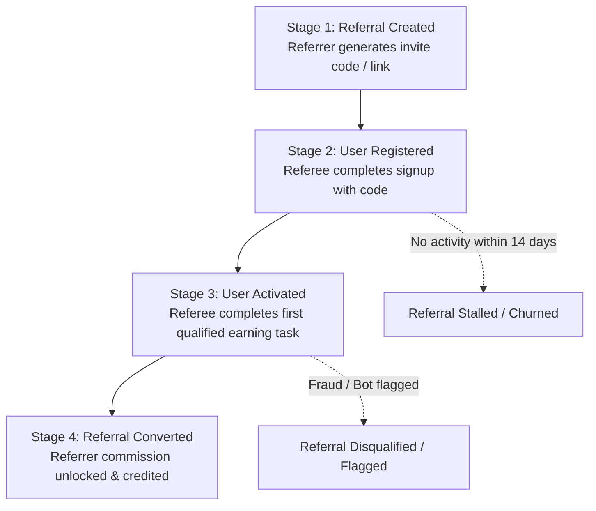
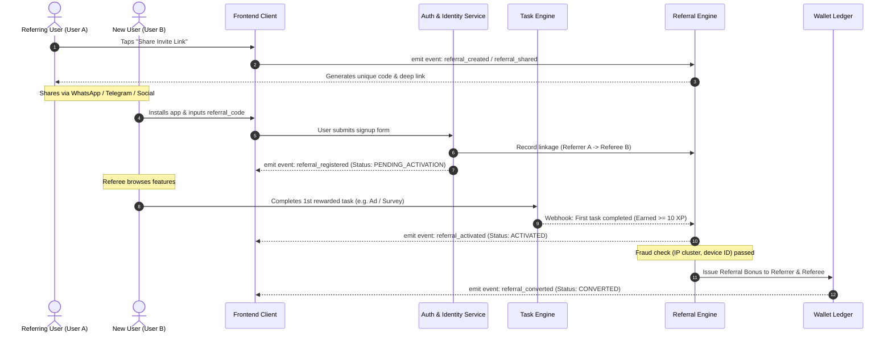
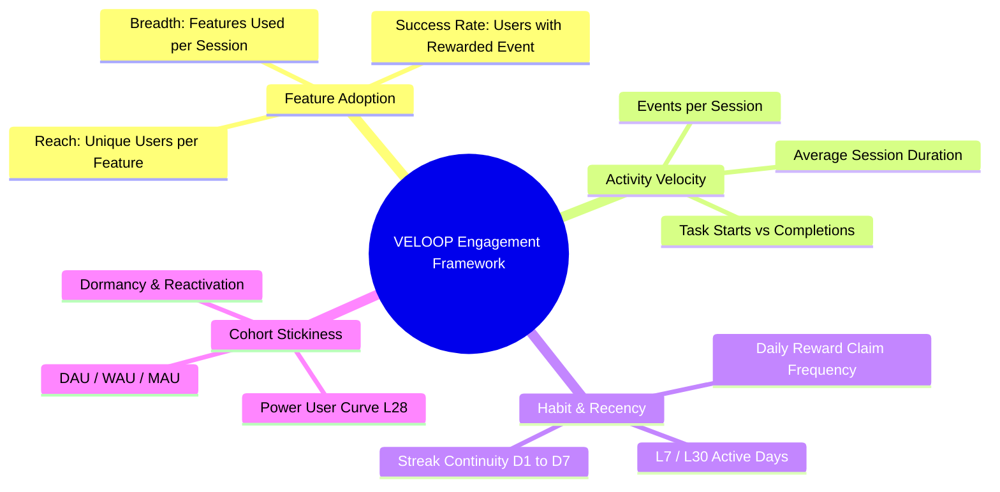

# VELOOP REWARDS — WORK PACKAGE E
## Referral & Engagement Analytics Specification
**Document ID:** VELOOP-DELIV-07  
**Deliverable Covered:** Deliverable 07 (Referral & Engagement Analytics)  
**Classification:** SIMULATED DATA — CREATED FOR ANALYTICAL TESTING  
**Status Standard:** Confirmed | Proposed | To Be Verified  

---

### 1. Executive Context & Objective

Viral acquisition and long-term user retention are the dual growth engines of VELOOP Rewards. A common failure in rewards platforms is treating a referral link click or a basic registration as a "converted referral." This leads to massive affiliate fraud, multi-accounting, and bloated marketing expenditure with zero revenue generation.

This specification addresses **Gap #3 (Severed Referral Attribution Linkage)** identified in the Product Data Audit:
1. Establishes a 4-stage **Referral Attribution Funnel** enforcing qualification gates.
2. Defines the relational **Referral Data Model** (`fact_referral_conversions`).
3. Standardizes multi-dimensional **User Engagement Metrics** (Feature Adoption, Repeat Usage, Cohort Retention, and DAU/MAU Stickiness), grounded in empirical data from `04_Daily_Activity` and `07_Feature_Usage`.

---

### 2. The 4-Stage Referral Conversion Funnel

To prevent paying referral bonuses for inactive or bot-generated signups, VELOOP must enforce a strict, sequential 4-stage referral lifecycle:

#### Detailed Stage Definitions & Qualification Gates:

1. **Stage 1 — Referral Created / Shared (`referral_created`, `referral_shared`):**
   * **Definition:** Existing user accesses the referral module and generates a personalized code or shares an invite deep link.
   * **Data Captured:** `referral_id`, `referrer_user_id`, `referral_code`, `channel` (WhatsApp, Telegram, Social Media, Direct Copy).
2. **Stage 2 — User Registered (`referral_registered`):**
   * **Definition:** A new user downloads the client and registers with the referrer's code attached.
   * **Qualification Rule:** Account status must be `Active` or `Pending Verification`. **No monetary bonus is distributed at this stage.**
   * **Data Captured:** `referral_id`, `referee_user_id`, `registered_timestamp`, `attribution_source`.
3. **Stage 3 — User Activated (`referral_activated`):**
   * **Definition:** The referred user reaches the "First-Mile Value Threshold" by completing at least **1 valid monetizable task** (e.g., watched 1 ad, completed 1 survey, or claimed Day-1 reward) within 14 days of registration.
   * **Qualification Rule:** Must pass anti-fraud device fingerprinting (cannot share device ID or payment destination with referrer).
   * **Data Captured:** `activation_timestamp`, `first_task_id`, `qualification_duration_hours`.
4. **Stage 4 — Referral Converted (`referral_converted`):**
   * **Definition:** System formally marks the referral as successful, triggering atomic double-entry ledger credits for both referrer and referee.
   * **Data Captured:** `conversion_timestamp`, `bonus_xp_amount`, `bonus_transaction_id`.

---

### 3. E1. Relational Referral Data Specification (`fact_referral_conversions`)

In the simulated behavior dataset, referral tracking is only represented by superficial share events and an unlinked `referral_code` in the user table. Below is the production relational schema required to connect referrers to referees:

| Field Name | Data Type | Required? | Definition | Source | Validation Rules | Status |
|---|---|---|---|---|---|---|
| `referral_id` | String (PK) | Yes | Unique referral relationship key (`REF_...`) | Referral Engine | Unique; regex: `^REF_[a-zA-Z0-9_\-]+$` | Proposed |
| `referrer_user_id` | String (FK) | Yes | Identifier of the referring user | Auth Session | Foreign key to `dim_users` | Confirmed |
| `referee_user_id` | String (FK) | Yes | Identifier of the newly acquired user | Auth Session | Foreign key to `dim_users`; $\ne \text{referrer\_id}$ | Proposed |
| `referral_code_used` | String | Yes | Specific code entered during onboarding | Auth Payload | Matches active `referral_code` in system | Confirmed |
| `creation_timestamp` | Timestamp | Yes | Time referral link was generated / code created | Referral Engine | ISO 8601 UTC timestamp | Confirmed |
| `registration_timestamp`| Timestamp | Yes | Time referee created account | Auth Database | $\ge \text{creation\_timestamp}$ | Proposed |
| `activation_timestamp` | Timestamp | No | Time referee completed 1st qualified task | Task Service | Nullable; $\ge \text{registration\_timestamp}$ | Proposed |
| `conversion_timestamp` | Timestamp | No | Time bonus was approved and posted | Wallet Ledger | Nullable; $\ge \text{activation\_timestamp}$ | Proposed |
| `referral_status` | String | Yes | State: `REGISTERED`, `ACTIVATED`, `CONVERTED`, `EXPIRED`, `FRAUD_DISQUALIFIED` | Referral Engine | Strict whitelist enum | Proposed |
| `sharing_channel` | String | Yes | Distribution channel: `WHATSAPP`, `TELEGRAM`, `INSTAGRAM`, `SMS`, `DIRECT_COPY` | Client SDK | Whitelist enum | Confirmed |
| `referrer_reward_tx_id`| String | No | Transaction ID crediting referrer's wallet | Wallet Ledger | Foreign key to `fact_wallet_transactions` | Proposed |
| `referee_reward_tx_id` | String | No | Transaction ID crediting referee's wallet | Wallet Ledger | Foreign key to `fact_wallet_transactions` | Proposed |
| `device_fingerprint_match`| Boolean| Yes | Flag indicating whether referrer & referee share hardware | Risk Service | Boolean (`true` indicates potential self-referral)| Proposed |

---

### 4. E2. User Engagement Analytics Framework

Based on empirical data from `04_Daily_Activity` (6,667 daily user records) and `07_Feature_Usage` (15 features), engagement must be measured across four operational dimensions:

#### 1. Feature Adoption & Penetration
* **Metric:** Feature Penetration Rate ($\%$)
* **Formula:**  
  $$\text{Penetration}_{\text{feature}} = \frac{\text{Unique Users Engaging with Feature in Window } T}{\text{Total Active Users (AU) in Window } T} \times 100$$
* **Simulated Benchmark (from `07_Feature_Usage`):**
  * Top Engaged Features: Watch Ads ($83.6\%$), Daily Reward ($83.5\%$), Streak Rewards ($83.2\%$).
  * Mid-Tier Features: Missions ($77.1\%$), Spin the Wheel ($76.3\%$).
  * Under-Adopted Features: Follow & Earn ($68.5\%$), Badges ($67.4\%$).
* **Analytical Value:** Identifies which features drive initial utility vs features suffering from discoverability friction.

#### 2. Repeat Usage & Habit Formation
* **Metric:** 7-Day Habitual User Percentage ($L7 \ge 4$)
* **Formula:**  
  $$\text{Habitual User Ratio} = \frac{\text{Count of Users with } \ge 4 \text{ Active Days in Rolling 7-Day Window}}{\text{Total WAU}} \times 100$$
* **Analytical Value:** Isolates core habitual earners from opportunistic visitors.

#### 3. Task Velocity & Engagement Depth
* **Metric:** Completed Tasks per Active User Day ($CTPD$)
* **Formula:**  
  $$CTPD = \frac{\sum \text{completed\_task\_count}}{\sum \mathbf{1}_{\{\text{active\_flag} = \text{'Yes'}\}}}$$
* **Simulated Baseline:** Mean session count is $1.14$ sessions/day; mean completed tasks per record is $0.78$ tasks/day (with heavy power users reaching up to 38 completed tasks in a single day).

#### 4. Active vs. Returning User Segmentation
To monitor platform vitality, users are segmented dynamically on any given calendar day $D$:

| User Cohort | Definition | Business Importance |
|---|---|---|
| **New Active User (NAU)** | First qualifying activity event occurs on Day $D$ ($\text{activity\_date} = \text{registration\_date}$). | Measures top-of-funnel acquisition health. |
| **Retained Active User (RAU)** | Active on Day $D$ and was also active on Day $D-1$. | Measures short-term day-over-day stickiness. |
| **Resurrected User (ReAU)** | Active on Day $D$ after being dormant for $\ge 14$ consecutive days. | Measures effectiveness of re-engagement pushes. |
| **Dormant User (DU)** | Zero activity events for $14\text{--}29$ consecutive days. | High churn risk; trigger lifecycle win-back campaigns. |
| **Churned User (CU)** | Zero activity events for $\ge 30$ consecutive days. | Base attrition; excluded from active reporting pools. |

#### 5. Platform Stickiness Ratio (DAU / MAU)
* **Formula:**  
  $$\text{Platform Stickiness} = \frac{\text{Daily Active Users (DAU)}}{\text{Monthly Active Users (MAU)}} \times 100$$
* **Interpretation:** Measures how frequently monthly active users return to the app. In rewards and casual gaming apps, a DAU/MAU ratio of $20\%\text{--}30\%$ represents solid engagement; $> 40\%$ represents best-in-class daily utility.
