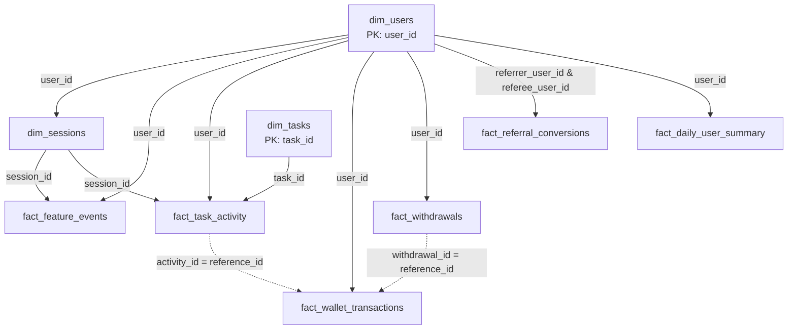

# VELOOP REWARDS — WORK PACKAGE H
## Logical Data Model & Enterprise ER Diagram
**Document ID:** VELOOP-DELIV-10  
**Deliverable Covered:** Deliverable 10 (Logical Data Model & ER Diagram)  
**Classification:** SIMULATED DATA — CREATED FOR ANALYTICAL TESTING  
**Status Standard:** Confirmed | Proposed | To Be Verified  

---

### 1. Architectural Modeling Principles

The VELOOP logical data model is architected following an enterprise **Dimensional Hybrid Schema** (Kimball Star-Snowflake hybrid with an append-only event log and a double-entry financial ledger).

#### Design Objectives:
1. **Financial Immutability:** Financial ledger entries (`fact_wallet_transactions`) and payout settlements (`fact_withdrawals`) are strictly append-only. State changes generate compensating or transition rows rather than in-place updates.
2. **High-Throughput Telemetry:** Clickstream events (`fact_feature_events`) are decoupled from transactional databases to prevent analytical queries from impacting transactional performance.
3. **Idempotent Referential Integrity:** Every fact table is linked to persistent dimension tables via immutable surrogate and business keys (`user_id`, `task_id`, `session_id`).

---

### 2. H4. Enterprise Entity-Relationship (ER) Diagram

The following diagram details the entities, primary keys (PK), foreign keys (FK), cardinalities, and core attributes across the analytical schema:

```mermaid
erDiagram
    dim_users ||--o{ dim_sessions : "initiates (1:N)"
    dim_users ||--o{ fact_feature_events : "generates (1:N)"
    dim_users ||--o{ fact_task_activity : "attempts (1:N)"
    dim_users ||--o{ fact_wallet_transactions : "owns (1:N)"
    dim_users ||--o{ fact_withdrawals : "requests (1:N)"
    dim_users ||--o{ fact_referral_conversions : "refers_as_advocate (1:N)"
    dim_users ||--o{ fact_referral_conversions : "referred_as_referee (1:1)"
    dim_users ||--o{ fact_daily_user_summary : "aggregated_daily (1:N)"
    dim_users ||--o{ fact_user_badges : "earns (1:N)"

    dim_sessions ||--o{ fact_feature_events : "contains (1:N)"
    dim_sessions ||--o{ fact_task_activity : "executes_within (1:N)"

    dim_tasks ||--o{ fact_task_activity : "defines (1:N)"

    fact_task_activity ||--o| fact_wallet_transactions : "triggers_credit (1:1)"
    fact_withdrawals ||--o| fact_wallet_transactions : "triggers_debit (1:1)"

    dim_users {
        string user_id PK "Permanent Global ID"
        timestamp registration_datetime "Signup Time"
        string registration_channel "Acquisition Source"
        string referral_code "Unique Invite Code"
        string primary_platform "Android/iOS/Web"
        string account_status "Active/Suspended/Pending"
        int current_xp_balance "Total XP Progress"
        decimal current_token_balance "Monetary Liability"
    }

    dim_sessions {
        string session_id PK "Unique Session Token"
        string user_id FK "Owner User"
        timestamp session_start "Foreground Time"
        timestamp session_end "Background/Timeout Time"
        int session_duration_seconds "Elapsed Time"
        string entry_point "Ingress Screen"
        string exit_feature "Egress Screen"
        int events_in_session "Event Count"
    }

    fact_feature_events {
        string event_id PK "ULID Event Key"
        string user_id FK "Subject User"
        string session_id FK "Session Context"
        timestamp event_datetime "Precise UTC Time"
        string feature_name "Product Feature Name"
        string event_name "Object_Action Name"
        string event_status "Success/Failed"
        int sequence_number "Chronological Counter"
        string idempotency_key "Deduplication Hash"
    }

    dim_tasks {
        string task_id PK "Task Definition ID"
        string task_title "Display Name"
        string task_category "Ad/Survey/Game/App"
        decimal base_reward_amount "Promised Payout"
        string base_reward_unit "XP/Gems/Tokens"
        string partner_network "AdMob/BitLabs/Internal"
        int cooldown_period_minutes "Rate-Limit Threshold"
    }

    fact_task_activity {
        string activity_id PK "Task Attempt Key"
        string user_id FK "Attempting User"
        string task_id FK "Task Reference"
        string session_id FK "Session Link"
        timestamp task_started_at "Start Timestamp"
        timestamp task_completed_at "Completion Timestamp"
        string task_status "Completed/Failed/Abandoned"
        string failure_reason "Taxonomy Code"
        string validation_status "Passed/Failed"
        string reward_status "Credited/Pending"
    }

    fact_wallet_transactions {
        string transaction_id PK "Ledger Entry Key"
        string user_id FK "Beneficiary/Debit User"
        timestamp transaction_timestamp "Ledger Commit Time"
        string transaction_type "REWARD_CREDIT/REDEMPTION"
        decimal amount "Mutation Magnitude"
        string currency_unit "XP/GEMS/TOKENS/USD"
        string balance_direction "CREDIT/DEBIT"
        decimal running_balance_after "Post-Commit Balance"
        string reference_id "Origin FK (activity/wd)"
        string related_reversal_id "Clawback Link"
    }

    fact_withdrawals {
        string withdrawal_id PK "Withdrawal Request Key"
        string user_id FK "Cash-Out User"
        decimal requested_amount "Gross Payout Amount"
        string payout_currency "Target Currency (USD/INR)"
        decimal tokens_debited "Platform Tokens Debited"
        string payout_method "PayPal/Bank/UPI/Crypto"
        string payout_gateway "Stripe/Cashfree/PayPal"
        string withdrawal_status "Requested/Processing/Completed"
        timestamp requested_timestamp "Submission Timestamp"
        timestamp settlement_timestamp "Settlement Timestamp"
        string rejection_reason_code "Rejection Code"
    }

    fact_referral_conversions {
        string referral_id PK "Referral Relationship Key"
        string referrer_user_id FK "Inviting User"
        string referee_user_id FK "New Acquired User"
        string referral_code_used "Code Entered"
        timestamp registration_timestamp "Signup Timestamp"
        timestamp activation_timestamp "First Task Completed"
        timestamp conversion_timestamp "Bonus Credited"
        string referral_status "Registered/Activated/Converted"
    }

    fact_daily_user_summary {
        string daily_summary_id PK "Compound Key (user+date)"
        string user_id FK "Subject User"
        date activity_date "Calendar Day"
        int session_count "Total Sessions"
        decimal total_duration_minutes "Total Active Time"
        int completed_tasks_count "Daily Completed Tasks"
        int streak_day_count "Active Streak Counter"
        string active_flag "Yes/No DAU Flag"
    }

    fact_user_badges {
        string badge_grant_id PK "Unique Grant Key"
        string user_id FK "Recipient User"
        string badge_id "Badge Definition Key"
        timestamp unlocked_at "Minting Timestamp"
        string badge_tier "Bronze/Silver/Gold"
    }
```

---

### 3. H1. Primary Key Specification

Every entity in the logical data model possesses an unambiguous, single-column primary key to guarantee uniqueness and high-speed indexing:

| Entity Name | Primary Key Name | Key Format & Data Type | Uniqueness Enforcement |
|---|---|---|---|
| `dim_users` | `user_id` | Alphanumeric UUIDv4 / Prefixed String | Generated by Auth Service at account creation |
| `dim_sessions` | `session_id` | Prefixed Alphanumeric (`SESS...`) | Generated by Client SDK / API Gateway at session inception |
| `fact_feature_events` | `event_id` | 26-character ULID | Generated by Client Analytics SDK at telemetry emission |
| `dim_tasks` | `task_id` | Alphanumeric (`TASK...`) | Defined in Task Management CMS |
| `fact_task_activity` | `activity_id` | Prefixed Alphanumeric (`ACT...`) | Generated by Task Service at task start |
| `fact_wallet_transactions`| `transaction_id` | Cryptographic Alphanumeric (`tx_wall_...`) | Generated by Wallet Core Engine on ledger write |
| `fact_withdrawals` | `withdrawal_id` | Prefixed Alphanumeric (`WD_...`) | Generated by Payout Service on cash-out submission |
| `fact_referral_conversions`| `referral_id` | Prefixed Alphanumeric (`REF_...`) | Generated by Referral Service on code attribution |
| `fact_daily_user_summary` | `daily_summary_id`| Compound String (`DS_{user_id}_{YYYYMMDD}`) | Generated by ETL Aggregation Pipeline |
| `fact_user_badges` | `badge_grant_id` | Prefixed Alphanumeric (`BDG_...`) | Generated by Gamification Engine on milestone unlock |

---

### 4. H2. Foreign Key & Relational Mappings

Foreign keys establish relational integrity across operational facts and analytical dimensions:

---

### 5. H3. Detailed Relationship Documentation

#### 1. One-to-One ($1:1$) Relationships:
* **`dim_users` to `fact_referral_conversions` (as Referee):** A newly registered user (`referee_user_id`) can be acquired through at most **one** referral relationship. (A user cannot be referred by multiple advocates).
* **`fact_task_activity` to `fact_wallet_transactions`:** For a completed, validated task attempt (`activity_id`), there is at most **one** corresponding `REWARD_CREDIT` ledger transaction. The ledger's `reference_id` maps $1:1$ back to `activity_id`.

#### 2. One-to-Many ($1:N$) Relationships:
* **`dim_users` to `dim_sessions` ($1:N$):** A single user initiates multiple continuous interaction sessions over their platform lifetime.
* **`dim_users` to `fact_feature_events` ($1:N$):** A user generates thousands of clickstream and feature interaction events.
* **`dim_users` to `fact_wallet_transactions` ($1:N$):** A user accumulates multiple credit, debit, exchange, and adjustment ledger records.
* **`dim_users` to `fact_withdrawals` ($1:N$):** An active earning user can request multiple cash-outs over time.
* **`dim_users` to `fact_referral_conversions` (as Referrer) ($1:N$):** A successful advocate user (`referrer_user_id`) can refer multiple new referees.
* **`dim_tasks` to `fact_task_activity` ($1:N$):** A single catalog task definition (e.g. `TASK0071`) is attempted thousands of times by different users.
* **`dim_sessions` to `fact_feature_events` ($1:N$):** A single session encapsulates all events executed between `session_start` and `session_end`.

#### 3. Many-to-Many ($M:N$) Relationships:
* **`dim_users` to `dim_tasks` ($M:N$ via `fact_task_activity`):** Users attempt many tasks, and each task is attempted by many users. The bridge entity `fact_task_activity` resolves this into two $1:N$ relationships.
* **`dim_users` to `dim_badges` ($M:N$ via `fact_user_badges`):** Users earn multiple badges, and badges are minted to multiple users. Resolved by `fact_user_badges`.

#### 4. Event & Transaction Relationships:
* **Telemetry Event to Transactional Ledger Boundary:**
  * Telemetry events (`fact_feature_events`) capture untrusted client activity (`task_completed`, `withdrawal_requested`).
  * Ledger entries (`fact_wallet_transactions`) capture trusted server-side double-entry balance mutations.
  * They are connected loosely via `reference_id` and `idempotency_key`, preventing race conditions and keeping high-throughput clickstream data separate from immutable financial ledgers.
