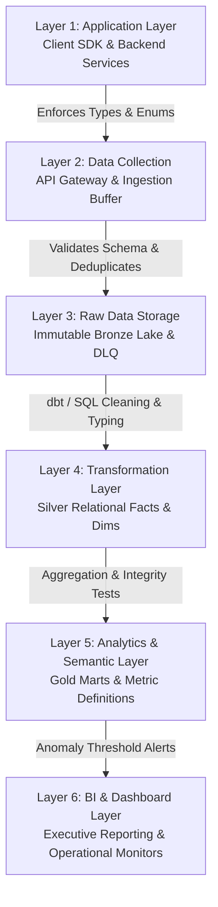

# VELOOP REWARDS — WORK PACKAGE L
## Data Quality Control Framework (6-Layer Defense Architecture)
**Document ID:** VELOOP-DELIV-14  
**Deliverable Covered:** Deliverable 14 (Data Quality Control Framework)  
**Classification:** SIMULATED DATA — CREATED FOR ANALYTICAL TESTING  
**Status Standard:** Confirmed | Proposed | To Be Verified  

---

### 1. Architectural Philosophy: Shift-Left Data Quality

Data quality cannot be achieved solely by cleaning dirty data downstream in BI dashboards. In high-volume rewards platforms, dirty records that reach the analytics layer produce incorrect financial liabilities, corrupted executive decisions, and undetected fraud.

This framework introduces a **Shift-Left Multi-Layer Defense System**, establishing deterministic gatekeepers across all six stages of the data pipeline:



---

### 2. The 6-Layer Data Quality Matrix

The following specification details the exact quality rules, detection logic, enforcement actions, and ownership across every pipeline layer:

| Layer | Inspection Point | Quality Rule & Check | Detection / Enforcement Logic | Failure Action | Responsible Owner |
|---|---|---|---|---|---|
| **1. Application** | Mobile App / Web Client | Enum whitelisting & String Sanitization | Pre-emission interceptor trims whitespace and lowercases enums (e.g. preventing `'success '`) | Prevents invalid payload generation | Mobile & Frontend Engineering |
| **1. Application** | Backend Auth & Services | Primary Key Uniqueness & Constraints | Database unique constraint: `UNIQUE (user_id)` and `UNIQUE (transaction_id)` | Rejects duplicate DB insert with 409 Conflict | Backend Engineering |
| **2. Data Collection** | API Gateway (Kinesis / PubSub) | Schema Contract Validation | JSON Schema validation checking required fields (`event_id`, `user_id`, `timestamp`) | Rejects invalid events with 400 Bad Request | Platform / Data Engineering |
| **2. Data Collection** | Ingestion Stream Buffer | Ingestion Idempotency & Deduplication | Redis sliding-window check on `idempotency_key` or `event_id` (30-minute deduplication window) | Drops duplicate retry events silently | Data Engineering |
| **3. Raw Storage** | Bronze Lake / GCS / S3 | Raw Landing & Dead-Letter Routing | Ingestion router isolates malformed JSON or unparseable timestamps into Dead-Letter Queue (DLQ) | Routes malformed payload to DLQ bucket | Data Engineering |
| **4. Transformation** | dbt / BigQuery Silver Layer | Referential Integrity Validation | `dbt test`: `relationships` test confirming `session_id` in `dim_sessions` and `user_id` in `dim_users` | Pipeline run fails or alerts on orphan count $> 0$ | Analytics Engineering |
| **4. Transformation** | dbt / BigQuery Silver Layer | Timestamp & Chronology Checks | SQL assertion: `task_completed_at >= task_started_at` and `last_login >= registration_datetime` | Flags chronologically impossible rows to anomaly table | Analytics Engineering |
| **4. Transformation** | dbt / BigQuery Silver Layer | Non-Negative Monetary Enforcements | SQL assertion: `amount > 0` and `running_balance >= 0` | Blocks ledger update if balance becomes negative | Analytics Engineering |
| **5. Analytics Layer**| Gold Marts / Semantic Models | Double-Entry Balancing Verification | Automated test: $\sum \text{Credits} - \sum \text{Debits} == \sum \text{User Balances}$ | Triggers P1 alert to finance if ledger drift detected | Data & Finance Engineering |
| **5. Analytics Layer**| Metric Aggregation Pipelines | Metric Completeness & Freshness | SLA check: confirms yesterday's partition is fully loaded by 02:00 UTC | PagerDuty alert if pipeline execution lags | Data Operations / On-Call |
| **6. BI & Dashboard** | Looker / Tableau / Streamlit | Anomaly & Outlier Boundary Alerts | Monitors rolling z-scores on DAU, task completions, and withdrawal requests ($z > 3.0$) | Highlights visual indicator; emails operations | BI & Analytics Team |

---

### 3. Layer-by-Layer Implementation Standards

#### Layer 1: Application Layer (Client SDK & Microservices)
* **Typed Domain Enums:** Replace raw strings in client code with strict TypeScript / Kotlin enum classes (`TaskStatus.COMPLETED`, `FeatureDomain.WATCH_ADS`).
* **Client Time Synchronization:** Mitigate mobile device clock skew by calculating `clock_skew_offset = server_response_time - client_device_time` upon login, stamping events with drift-corrected UTC timestamps.

#### Layer 2: Data Collection & Gateway Layer
* **Ingestion Gateway Filter:**
  ```python
  # API Gateway Schema Validator (FastAPI / Node.js)
  def validate_telemetry_event(payload: dict):
      required_keys = {"event_id", "user_id", "timestamp", "event_name", "feature_domain"}
      if not required_keys.issubset(payload.keys()):
          raise HTTPException(status_code=400, detail="Schema contract violation: missing keys")
      if payload["event_id"] in redis_cache:
          return {"status": "deduplicated"} # Drop duplicate retry
      redis_cache.setex(payload["event_id"], 1800, 1) # 30 min deduplication window
  ```

#### Layer 3: Raw Storage & Dead-Letter Queue (DLQ)
* All unprocessed events land in an immutable, append-only object store (`gs://veloop-data-lake-raw/year=2026/month=11/`).
* Events that fail JSON parsing or carry corrupted headers are isolated into `gs://veloop-data-lake-dlq/` for automated replay once bug patches are deployed.

#### Layer 4: Transformation Layer (dbt & SQL Quality Checks)
Automated dbt YAML tests execute on every pipeline run before merging into production:
```yaml
version: 2
models:
  - name: fact_feature_events
    columns:
      - name: event_id
        tests:
          - unique
          - not_null
      - name: user_id
        tests:
          - not_null
          - relationships:
              to: ref('dim_users')
              field: user_id
      - name: event_status
        tests:
          - accepted_values:
              values: ['Started', 'Success', 'Abandoned', 'Failed']
```

#### Layer 5: Analytics Layer (Ledger Drift & Reconciliation Audits)
A daily automated reconciliation query verifies that the sum of all transactional ledger mutations equals the sum of user balances in `dim_users`:
```sql
-- Daily Financial Reconciliation Test
WITH ledger_balance AS (
  SELECT user_id,
         SUM(CASE WHEN balance_direction = 'CREDIT' THEN amount ELSE -amount END) AS computed_balance
  FROM fact_wallet_transactions
  GROUP BY user_id
),
dimension_balance AS (
  SELECT user_id, current_token_balance
  FROM dim_users
)
SELECT l.user_id, l.computed_balance, d.current_token_balance,
       (l.computed_balance - d.current_token_balance) AS ledger_drift
FROM ledger_balance l
JOIN dimension_balance d ON l.user_id = d.user_id
WHERE ABS(l.computed_balance - d.current_token_balance) > 0.0001;
-- ALERT: IF ROWS RETURNED > 0, HALT PAYOUT PIPELINE IMMEDIATELY
```

#### Layer 6: BI & Dashboard Layer (Monitoring & Circuit Breakers)
* **Visual Data Health Status:** Every dashboard includes an automated freshness pill (*"Data Freshness: 24 mins ago | Quality Score: 99.98%"*).
* **Circuit Breaker:** If data freshness lags by more than 4 hours or if un-reconciled ledger drift is detected, executive metrics are watermarked with an operational warning banner: `[WARNING: RECONCILIATION IN PROGRESS — DATA UNVERIFIED]`.
