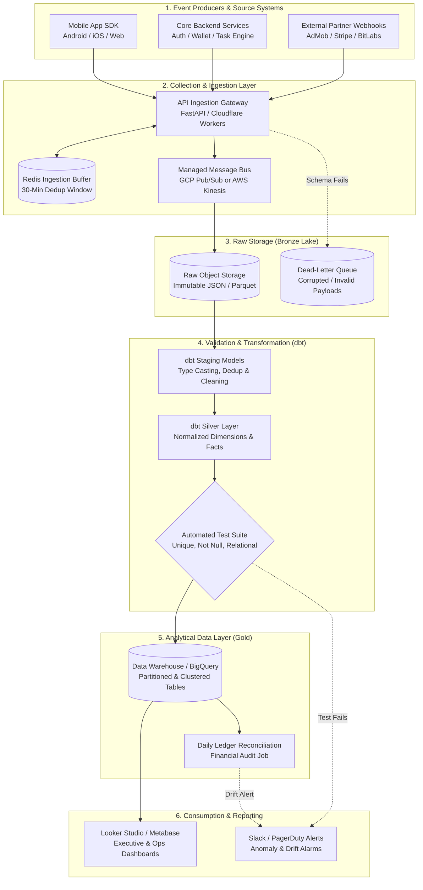

# VELOOP REWARDS — WORK PACKAGE O
## Data Pipeline Architecture & Operating Model
**Document ID:** VELOOP-DELIV-17  
**Deliverable Covered:** Deliverable 17 (Data Pipeline Proposal & Operating Model)  
**Classification:** SIMULATED DATA — CREATED FOR ANALYTICAL TESTING  
**Status Standard:** Confirmed | Proposed | To Be Verified  

---

### 1. Architectural Philosophy: Pragmatic, Lean & Scalable

In strict compliance with the **VELOOP Architecture Guidelines**:
> *"Do not recommend expensive infrastructure merely because it sounds professional. The architecture must be practical for a developing product and scalable when justified."*

For a developing rewards ecosystem with an initial baseline of $1,000\text{--}50,000$ active users, deploying an over-engineered multi-cluster Apache Spark/Flink/Kafka streaming infrastructure introduces unnecessary cloud bills ($\$5,000+/mo$) and heavy DevOps maintenance overhead.

Instead, VELOOP adopts a **Lean Serverless Lakehouse Architecture** leveraging managed cloud services (Google Cloud Platform / BigQuery or AWS / Snowflake), combined with **dbt (data build tool)** for transformations. This delivers sub-second dashboard performance, ACID financial consistency, and cost-effective scaling (operating under $\$250/mo$ at current scale).

---

### 2. End-to-End Data Pipeline Architecture

---

### 3. Pipeline Component Specifications

#### 1. Source Systems & Event Producers
* **Client SDKs (Android, iOS, Web):** Emits client-side behavioral events (`task_viewed`, `task_started`, `task_completed`, `spin_started`). Automatically enriches payloads with device, app version, and session metadata.
* **Core Backend Microservices:** Emits transactional and state-change events (`user_registered`, `reward_credited`, `streak_updated`, `withdrawal_requested`).
* **Third-Party Partner Webhooks:** Receives asynchronous completion postbacks from ad networks (AdMob), survey routers (BitLabs), and payout gateways (Stripe, PayPal).

#### 2. Collection & Ingestion Layer
* **Technology:** Serverless API Gateway + Managed Queue (GCP Pub/Sub or AWS SQS).
* **Throughput Capacity:** Scalable from 10 events/sec to 10,000+ events/sec without provisioning physical servers.
* **Ingestion Dedup Buffer:** Managed Redis instance checks `idempotency_key` and `event_id` within a 30-minute sliding window to absorb mobile client network retry storms.

#### 3. Raw Storage Layer (Bronze Lake)
* **Technology:** Google Cloud Storage (GCS) or AWS S3.
* **Format:** Raw, uncompressed/snappy-compressed append-only JSON files partitioned by date and hour (`gs://veloop-lake-raw/year=2026/month=11/day=01/hour=12/`).
* **Dead-Letter Queue (DLQ):** Payloads failing JSON parsing or schema validation are automatically routed to `gs://veloop-lake-dlq/` for developer inspection and replay.

#### 4. Validation & Transformation Layer (Silver Layer)
* **Technology:** **dbt Core (data build tool)** running automated SQL transformations against BigQuery / Snowflake.
* **Execution Frequency:**
  * **Near-Real-Time Stream:** Micro-batch streaming into staging tables every 5 minutes.
  * **Hourly Transformations:** Re-indexes operational tables (`fact_withdrawals`, `fact_task_activity`).
  * **Daily Aggregations:** Generates analytical marts at 01:00 UTC.
* **Quality Assurance Gate:** Every dbt run executes 40+ automated integrity tests (`unique`, `not_null`, `relationships`, non-negative numeric constraints). If any critical assertion fails, downstream updates are halted and an alert is dispatched.

#### 5. Analytical Data Layer (Gold Layer)
* **Technology:** Partitioned and clustered columnar tables in **Google BigQuery** (or PostgreSQL with TimescaleDB for ultra-low-budget deployments).
* **Table Partitioning Strategy:**
  * `fact_feature_events`: Partitioned by `DATE(event_datetime)`, clustered by `feature_name`, `user_id`.
  * `fact_wallet_transactions`: Partitioned by `DATE(transaction_timestamp)`, clustered by `currency_unit`, `transaction_type`.
  * `fact_withdrawals`: Partitioned by `DATE(requested_timestamp)`, clustered by `withdrawal_status`, `payout_method`.
* **Cost Efficiency:** Clustering eliminates 85% of query byte scans, keeping BigQuery query costs negligible ($< \$30/mo$).

#### 6. BI & Dashboard Consumption Layer
* **Technology:** **Looker Studio** (free tier to start) or **Metabase** (open-source self-hosted on a \$20/mo VM).
* **Refresh Schedule:**
  * Executive Cockpit: Cached hourly; manual refresh available.
  * Withdrawal Operations Monitor: Auto-refreshes every 15 minutes.
  * Retention Cohort Matrix: Refreshes daily at 03:00 UTC.

---

### 4. Operating Model, Monitoring & Failure Handling

#### 1. Pipeline Monitoring & Health Observability:
* **Metric Freshness Monitor:** Alert triggers if the gap between current time and the most recent event partition exceeds 30 minutes.
* **Data Volume Drift Detection:** Automated SQL monitor flags if daily event volume drops by $> 30\%$ or spikes by $> 150\%$ compared to the 7-day rolling average.
* **Ledger Reconciliation Alert:** Hourly cron tests:
  $$\sum \text{Credits} - \sum \text{Debits} == \sum \text{User Balances}$$
  If variance is non-zero, an emergency P0 Slack alert is fired to Finance and Engineering Leads.

#### 2. Failure Handling & Disaster Recovery:
* **Replay Protocol:** If transformation bugs are introduced, the immutable Bronze Lake allows complete historical replay. The dbt pipeline can be wiped and re-executed from raw storage (`dbt run --full-refresh`).
* **DLQ Replay Tool:** A simple Python CLI script (`replay_dlq.py`) re-submits patched payloads from the DLQ back into the ingestion gateway.

#### 3. RACI Operating Ownership Matrix:

| Operational Area | Responsible (R) | Accountable (A) | Consulted (C) | Informed (I) |
|---|---|---|---|---|
| **Event Instrumentation** | Mobile / Web Engineers | Frontend Lead | Product Analyst | Product Manager |
| **Ingestion Gateway & Message Bus** | Platform Engineer | Lead Architect | Data Engineer | Analytics Lead |
| **dbt Pipelines & Data Marts** | Analytics Engineer | Lead Data Engineer | Product Analyst | BI Developers |
| **Financial Ledger Reconciliation** | Analytics Engineer | Lead Data Engineer | CFO / Finance Lead | Executive Team |
| **Dashboard Uptime & KPI Accuracy** | BI Analyst | Product Analytics Lead| Product Managers | C-Suite |
