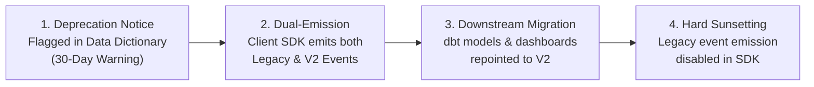

# VELOOP REWARDS — WORK PACKAGE Q
## Analytics Change Management Protocol & Metric/Event Change Log
**Document ID:** VELOOP-DELIV-19  
**Deliverable Covered:** Deliverable 19 (Analytics Change Management Protocol)  
**Classification:** SIMULATED DATA — CREATED FOR ANALYTICAL TESTING  
**Status Standard:** Confirmed | Proposed | To Be Verified  

---

### 1. Change Management Protocol & Governance Rules

VELOOP is an actively developing product. As game features evolve, reward values adjust, and payment gateways expand, unmanaged changes in event definitions or schema columns can cause catastrophic downstream failures: breaking executive dashboards, falsifying retention cohorts, and invalidating historical metrics.

#### Protocol Standard Operating Procedure (SOP):
1. **No Breaking Telemetry Changes Without Deprecation Windows:**
   * An event name or payload schema cannot be modified in-place. If an event structure changes, a new version must be published (e.g. `v2`) or run in parallel for at least a **30-day migration window**.
2. **Schema Migration Review Board (SMRB):**
   * Any change impacting schema fields, KPI definitions, or event names requires approval from the Product Analytics Lead, Engineering Lead, and BI Lead.
3. **Automated CI/CD Breaking-Change Tests:**
   * PRs modifying client tracking code are tested against JSON schema contracts. Any PR altering an existing event payload without updating the Data Dictionary fails continuous integration.

---

### 2. Metric & Event Change Log

Below is the formal **Metric / Event Change Log** tracking foundational migrations and proposed production standardizations across VELOOP:

| Date | Change Summary | Old Definition | New Definition | Reason | Affected KPIs | Affected Dashboards | Affected Reports | Owner | Version |
|---|---|---|---|---|---|---|---|---|---|
| **2026-10-15** | Standardization of Casing in Telemetry Events | Mixed casing (`missions`, `daily reward`, `wallet`, `watch ads`) | Uniform Title Case in `feature_name` (`Missions`, `Daily Reward`) and snake_case in `event_name` | Prevents SQL `GROUP BY` fragmentation identified in Data Quality Audit (DQI-03) | Feature Penetration, Total Events Logged | Dashboard 1 (Exec), Dashboard 3 (Engagement) | Weekly Executive Summary | Lead Data Engineer | v1.1.0 |
| **2026-10-20** | Enforcing `event_status` Whitespace Trimming | Unsanitized strings including `'success '` (with trailing space) | Strict enum whitelist: `['Started', 'Success', 'Abandoned', 'Failed']` with automatic trim | Eliminates silent dropouts in SQL `WHERE event_status = 'Success'` queries (DQI-04) | Task Completion Rate (TCR), Success Event Counts | Dashboard 3 (Engagement) | Feature Operations Monitor | Mobile SDK Lead | v1.1.1 |
| **2026-10-25** | Introduction of Dedicated Wallet Ledger Model | Implicit balance derived from UI event `wallet_viewed` and daily flag `wallet_activity` | Immutable append-only double-entry ledger table `fact_wallet_transactions` | Fixes Gap #1; enables financial auditability, token velocity tracking, and point-in-time balance checks | Gross Issuance, Net Token Liability, Ledger Drift | Dashboard 1 (Exec), Dashboard 5 (Wallet) | Monthly Financial Statement | Core Backend Architect | v2.0.0 |
| **2026-10-28** | Decoupling Task Completion from Balance Credit | Assumed `task_completed` equals immediate wallet balance credit | Decoupled client `task_completed` from backend ledger event `reward_credited` | Asynchronous offerwall validation, bot filtering, and partner postback delays (Gap #8) | Reward Settlement Latency, Validation Pass Rate | Dashboard 3 (Engagement), Dashboard 4 (Rewards) | Fraud & Risk Report | Product Analytics Lead | v2.0.1 |
| **2026-11-01** | Formalization of 4-Stage Referral Funnel | Binary code attachment (`referral_code` in user table) | 4-Stage Funnel: `Created -> Registered -> Activated -> Converted` | Eliminates paying bonuses for inactive/bot signups (Gap #3) | Referee Activation Rate (RAR), Viral Coefficient ($K$) | Dashboard 7 (Referrals) | Monthly Growth Review | Growth Product Manager | v2.1.0 |
| **2026-11-05** | Addition of UPI & Instant Bank Payout Rails | Payouts restricted to manual PayPal / Bank Transfer | Added `UPI` and `CASHFREE_INSTANT` to `payout_method` enum | Expanding Indian user market penetration and lowering transaction fees | Median Payout SLA Latency, Method Distribution | Dashboard 6 (Withdrawals) | Treasury Liquidity Report | Payments Lead | v2.2.0 |
| **2026-11-10** | KPI Definition Update: Daily Active Users (DAU) | Any session start event qualified user as active | Requires at least 1 qualified interaction event (excluding passive background pings) | Eliminates phantom DAU inflation from background app refresh tokens | DAU, WAU, Platform Stickiness ($DAU/MAU$) | All Dashboards | All Executive Decks | Head of Analytics | v2.2.1 |

---

### 3. Deprecation & Migration Workflow

When an event or field is scheduled for deprecation, the following 4-step workflow must be executed:

